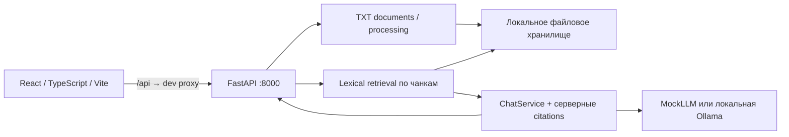

# FinDocs — реализованная архитектура TXT-MVP

**Срез: 19 ноября 2026 года.** Этот файл описывает код в `main` после PR #15 и #16. Исходный [`architecture.md`](architecture.md) — проектная/целевая архитектура от сентября 2026 года, включающая ещё не реализованные компоненты. Решения об изменениях согласуются через [`decisions.md`](decisions.md).

## Поток данных

## Реализовано

- **Frontend:** клиентские проверки файлов, последовательные `POST /documents`, polling статусов, список и удаление, область поиска, вопрос/ответ, отдельная панель цитат. `VITE_USE_MOCK=false` использует реальный HTTP-клиент; Vite перенаправляет `/api/*` на FastAPI без префикса.
- **Документы:** `POST /documents` принимает один UTF-8 TXT размером до 10 МиБ, возвращает `202`, обработка выполняется фоновым заданием приложения. `GET /documents`, `GET /documents/{id}`, `DELETE /documents/{id}` управляют библиотекой.
- **Хранение:** `LocalFileDocumentRepository` сохраняет оригинал, метаданные и результаты в `FINDOCS_DATA_DIR` (по умолчанию `backend/data`). Это **не PostgreSQL** и не многопользовательское хранилище.
- **Обработка:** UTF-8/BOM, текстовые блоки и чанки с `CHUNK_SIZE=350`, `CHUNK_OVERLAP=50`, токенизатор `multilingual-e5-small/tokenizer.json`, закреплённый по версии и SHA-256. Использование этого токенизатора **не создаёт embeddings**.
- **Поиск:** детерминированный лексический `LexicalRetriever` с `TOP_K=3`, ограниченной логикой fallback и расширения соседних чанков; `document_ids=null` означает все готовые, `[]` запрещён API.
- **Генерация:** `ChatService` и `LLMAdapter` с `MockLLM` либо `OllamaLLMAdapter`. Модель выбирается `FINDOCS_LLM_MODEL` без изменения кода. Сервер формирует цитаты из исходных TXT, а не из текста модели.
- **Ошибки:** статусы ответа `answered`, `partial`, `insufficient_info`; ошибки API и сетевые сбои отделены от недостатка информации. Цитаты отображают готовый `Source.quote` (индексы в Python Unicode не следует пересчитывать в JS).

## Ограничения и границы

Сейчас нет PDF/DOCX/OCR, векторного индекса, embeddings, PostgreSQL/pgvector, streaming, авторизации, истории диалогов и production-оркестрации. Обработка фоновых задач и файловое хранилище рассчитаны на локальный MVP с одним процессом FastAPI.

## Проверки

- Независимый QA Backend 0.8 после исправлений — [PR #15](https://github.com/Framyrite/FinDocs/pull/15).
- Интеграция интерфейса с API — [PR #16](https://github.com/Framyrite/FinDocs/pull/16).
- Инструкции установки и проверки — [корневой README](../README.md), [backend](../backend/README.md), [frontend](../frontend/README.md), [QA](../qa/README.md).

Исторические эксперименты и финальные отчёты не заменяются этим обзором. Документ фиксирует **что уже реализовано**, а не обещает будущие этапы.
