# FinDocs MVP 2.0 — Архитектура, модель данных и миграция

**Документ 2 из 4** комплекта MVP 2.0:

1. `product-requirements.md` — продукт, решения, команда, план.
2. **`architecture2.0.md`** — этот документ: C4, модули, модель данных, жизненные циклы, обработка, предпросмотр, поиск, чат, развёртывание, бэкапы.
3. `mvp2.0_contracts.md` + `openapi.yaml` — контракты API и внутренних модулей.
4. `security-qa.md` — права, информационная безопасность, тестирование.

Также: `decisions.md` — ADR-021…040 со статусами; `sql/` — эталонная схема PostgreSQL по миграциям, RLS и 186 воспроизводимых проверок (`sql/README.md`).

| Поле | Значение |
|---|---|
| Исходный код | `main` @ `8120430` (в коде после `b1eadf6` изменений нет) |
| Редакция | 3.1 (28.11.2026): решения Максима №1–24, доработки 1–7, локальные уточнения 28.11 |
| Статус | **Draft на согласование**. Принятые решения — `approved` в `decisions.md`; зависящие от экспериментов и инфраструктуры — `open` |

### Что изменено по ревью

| Замечание | Где закрыто |
|---|---|
| B-01 составные связи и provenance | §5.3, `sql/0001_core.sql`, `sql/0003_chats.sql`, `sql/0004_embeddings.sql`, тесты `10_*`, `20_*`, `30_*` |
| B-02 RLS: приватность, роли, служебные полномочия | §5.5, тесты `40_rls.sql`, `60_pool_context.sql` |
| B-04 жизненный цикл документа, run и embeddings | §7.1, §7.7, §8.3–8.5 |
| B-05 аренда и fencing задач | §7.7, тест `50_queries_jobs.sql` |
| B-06 конкурентность сообщений | §9.1, `mvp2.0_contracts.md` §7, тест `20_chats.sql` |
| B-07 производные данные удалённых документов | §9.3–9.4 (политика — `open` №14) |
| B-09 состояния пространства, аккаунт, папки | §5.6, `mvp2.0_contracts.md` §9 |
| B-10 файлы, квоты, бэкап | §6, §13.5 |
| B-11 миграции и порядок включения | §13.2, §13.3 |
| T-01, T-02, T-03, T-06–T-09, T-12, T-14, T-16 | §6.1, §7.7, §7.6, §7.2–7.5, §8, §5.4, §13.4, `decisions.md` |
| Редакция 3: удаление только своих документов для editor | §5.3 (I-23), §5.5, `sql/0001_core.sql`, тест `45_delete_policy.sql` |
| Редакция 3: открытая регистрация, код восстановления | §11.1, `security-qa.md` §3 |
| Редакция 3: предпросмотр PDF/DOCX | §7.8, `mvp2.0_contracts.md` §11 |
| Редакция 3: без переноса данных MVP 1.0 | §14 |
| Редакция 3, доработка 4: автор после удаления аккаунта | §5.2, §5.6 |
| Редакция 3, доработка 5: точка повторного применения удалений | §13.5, тест `45_delete_policy.sql` |
| Редакция 3, доработка 6: скрытие ответа целиком | §9.3, `mvp2.0_contracts.md` §7.4 |
| B-03, B-08, B-12, T-05, T-10, T-11, T-13, T-15 | `security-qa.md`, `mvp2.0_contracts.md`, `product-requirements.md` |

---

## 1. Текущее → целевое состояние

| Область | MVP 1.0 (факт) | MVP 2.0 (цель) | Статус |
|---|---|---|---|
| Пользователи | нет | открытая самостоятельная регистрация (email + пароль, без подтверждения email), серверные сессии в cookie, код восстановления | approved |
| Изоляция | одна общая библиотека | пространство (workspace) — граница данных, поиска и прав; RLS как второй рубеж | approved |
| Метаданные | `LocalFileDocumentRepository` (`meta.json`, `result.json`) | PostgreSQL 16, SQLAlchemy 2 + Alembic, схема `findocs` | approved |
| Оригиналы | `original.bin` на диске | `BlobStorage` на локальном томе + учёт в `blob_objects` | approved |
| Форматы | UTF-8 TXT | TXT + PDF (текстовый слой) + DOCX; OCR — нет; предпросмотр PDF и DOCX в интерфейсе | approved (подход к предпросмотру — proposed) |
| Фоновая обработка | `BackgroundTasks` в процессе API | очередь `jobs` в PostgreSQL с fencing, отдельный процесс worker | approved |
| Поиск | `LexicalRetriever`, `TOP_K=3` | lexical (точка отсчёта и резерв) / FTS / vector / hybrid; стартовая embedding-модель — e5-small | approved; окончательный выбор — open до эксперимента |
| Источники | символьные смещения в TXT | якоря TXT/PDF/DOCX + версия обработки (`run_id`) + снимок цитаты с проверкой происхождения в БД | approved |
| Чат | `POST /chat/ask` без истории | приватные чаты в БД, идемпотентность, fencing генерации, ограниченная история | approved |
| API | без префикса и без auth | `/api/v1`, OpenAPI 3.1 как источник истины | approved |
| Развёртывание | dev-скрипты | Docker Compose локально и в командном окружении: proxy + api + worker + postgres + ollama + backup; выделенного сервера нет | approved |
| Данные MVP 1.0 | — | **не переносятся**: MVP 2.0 начинает с чистой БД, MVP 1.0 остаётся отдельной версией | approved |

**Сохраняется:** модульный монолит FastAPI (ADR-005); `LLMAdapter` с `MockLLM` и `OllamaLLMAdapter` (ADR-017, расширение контракта — §10); токенизатор `multilingual-e5-small` и чанки 350/50 (ADR-009); UUID документа (ADR-010); серверные цитаты (ADR-018); статусы `uploaded/processing/ready/error` и `answered/partial/insufficient_info`; конверт ошибки; CI без тяжёлой LLM (ADR-020).

---

## 2. Принципы

1. **Авторизация на сервере в каждом запросе** через `AccessService`. RLS — второй рубеж, а не замена.
2. **Scope никогда не расширяется молча**: пустой, отсутствующий или частично невалидный scope — ошибка.
3. **Фильтр доступа до ранжирования**: scope и `workspace_id` применяются внутри SQL-запроса поиска.
4. **Документ — недоверенные данные**: и как файл (парсинг с ограничениями ресурсов), и как текст (prompt injection).
5. **Цитата — проверяемая подстрока** извлечённого текста конкретного run. Проверка — в коде и в ограничениях БД.
6. **Каждый инвариант помечен, кто его обеспечивает**: БД (ограничение или триггер, есть SQL-тест) или сервис (есть integration-тест). §5.3.
7. **At-least-once для фоновых задач**: обработчики идемпотентны, публикуют результат только при действующей аренде. Exactly-once не утверждается.
8. **Минимум инфраструктуры**: без Redis, Celery, Kubernetes, микросервисов и отдельной векторной БД.
9. **Без содержимого в логах** (`security-qa.md` §4.9).

---

## 3. C4

### 3.1. Context

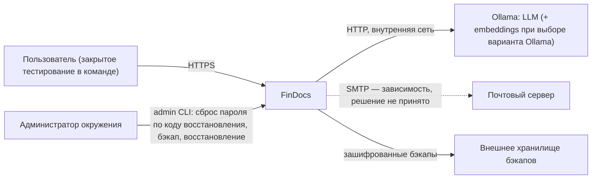

### 3.2. Container

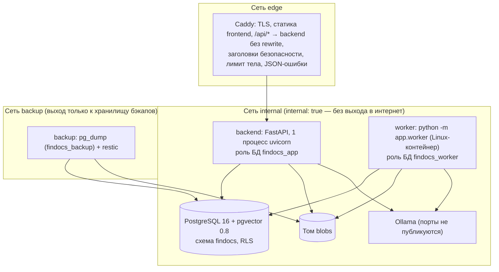

- Frontend и API на одном origin: CORS выключен, cookie `SameSite=Lax`.
- API работает **одним процессом uvicorn**. Внутрипроцессные семафоры (LLM, Argon2id) поэтому глобальны (§13.4). Масштабирование API — отдельное решение с переносом семафоров в PostgreSQL.
- Worker — тот же образ backend с другим entrypoint. Запускается **только как Linux-контейнер на любой ОС разработчика**: `rlimit` в Windows недоступен (T-03).

### 3.3. Развёртывание

Выделенного сервера нет (решение №24): разработка и тестирование идут локально и в командном окружении на Docker Compose. Требования к оборудованию и производительности определяются позже, по результатам замеров (NFR-PERF).

| Окружение (`FINDOCS_ENV`) | Запуск | БД | LLM / embeddings | Ограничения |
|---|---|---|---|---|
| `dev` | `docker compose up db worker` + `uvicorn` + `npm run dev` | контейнер `pgvector/pgvector:0.8.0-pg16@sha256:…` | `mock` или локальная Ollama | Vite проксирует `/api` без rewrite |
| `test` (CI) | service-контейнер того же образа | одноразовая, `alembic upgrade head` | `mock` / `MockEmbedding` | без сети к Ollama |
| `stand` (командное тестирование) | `docker compose -f compose.stand.yml up -d` на машине участника или любом сервере команды | том `pgdata` | Ollama в compose, модели загружены заранее | старт **отказывается** при `debug`, `legacy_single_user`, `mock` LLM/embeddings, пустых секретах; HTTPS через Caddy (локальный CA для `*.localhost`) |

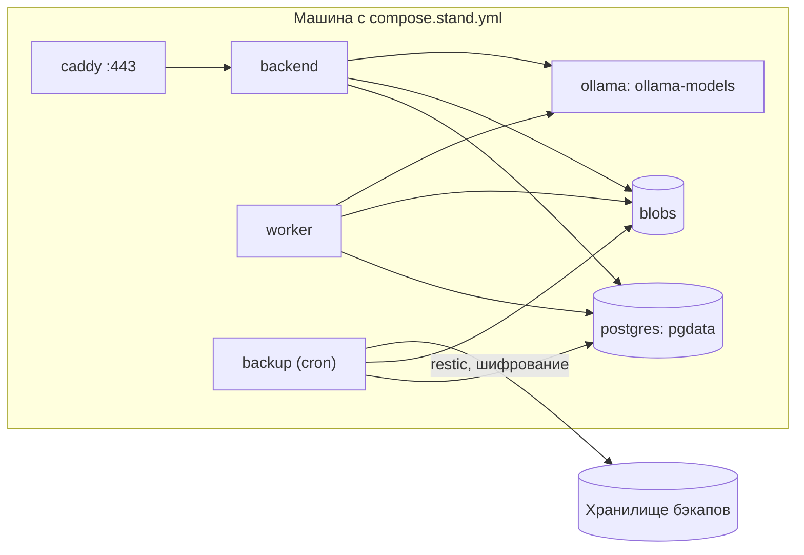

Перезапуск: состояние хранится только в `pgdata` и `blobs`. При старте backend сверяет ревизию миграций (не `head` → `/api/ready` = 503) и флаг незавершённого восстановления (§13.5). Worker возвращает в очередь задачи с истёкшей арендой (§7.7), sweeper закрывает зависшие генерации (§9.1).

Открытие сервиса внешним пользователям — отдельное решение. До него нужно решить подтверждение email, обработку персональных данных, ИБ и инфраструктуру (решение №21).

---

## 4. Модули и владельцы слоёв

```text
backend/app/
  main.py, worker.py, admin/            # композиция, entrypoint worker, CLI
  core/        config, logging, request_id, errors, security headers, origin/CSRF middleware
  db/          engine, UnitOfWork, set_config контекста, checkin RESET       ← Артём
  repositories/ documents, processing, jobs, chats, workspaces, users        ← Артём
  storage/     BlobStorage, BlobKey, GC                                      ← Артём
  auth/        пароли, сессии, токены, throttle                              ← Максим
  workspaces/  AccessService, участники, приглашения                         ← Максим
  folders/, documents/                                                       ← Максим
  processing/  txt (есть), pdf, docx, extract_child, chunking (есть), anchors ← Максим (Иван — при подтверждении)
  jobs/        обработчики задач, sweeper                                    ← Максим (оркестрация), Артём (SQL очереди)
  retrieval/   lexical (есть), fts, vector, hybrid, scope                    ← Максим; SQL поиска — Артём
  embeddings/, chat/, llm/                                                   ← Максим
  api/v1/                                                                    ← Максим
```

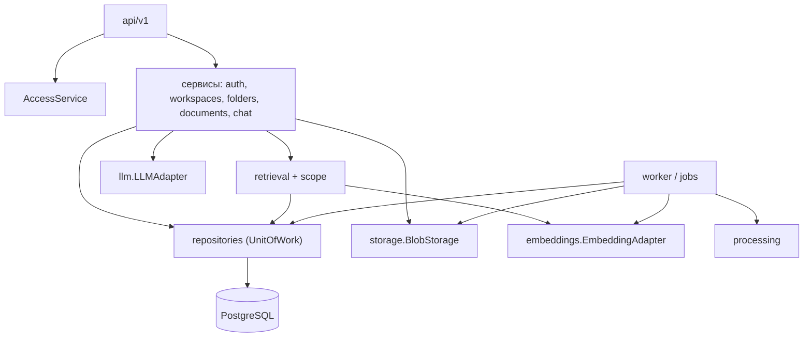

**Правила зависимостей** (import-linter в CI):

- `api` обращается только к сервисам.
- Сервисы читают пользовательские данные только с `AccessContext`, полученным от `AccessService.require(...)`.
- `processing` не знает про HTTP и пользователей. `llm` не знает про БД.
- `retrieval` получает готовый `ResolvedScope` и расширить его не может.

Сигнатуры между слоями описаны в `mvp2.0_contracts.md` §14.

---

## 5. Модель данных

Схема — в `sql/` по миграциям: `0001_core`, `0002_auth`, `0003_chats`, `0004_embeddings`. Роли, схема и расширения создаются в `00_bootstrap`. Этот раздел объясняет решения. Сами DDL здесь не повторяются, чтобы не было двух источников.

### 5.1. ERD

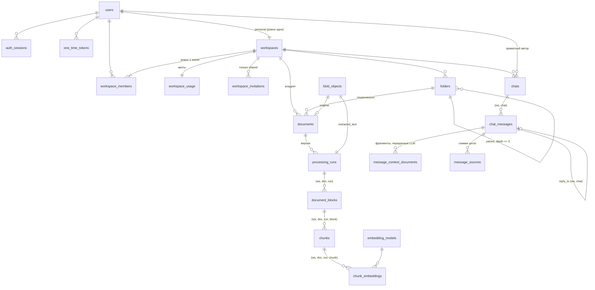

`jobs`, `audit_events`, `maintenance_flags` и `auth_throttle` с остальными таблицами внешними ключами не связаны.

### 5.2. Кто владеет данными

| Сущность | Владелец | Кто видит | При удалении владельца |
|---|---|---|---|
| Личное пространство | пользователь (`personal_owner_id`, единственный участник) | только он | удаляется вместе с аккаунтом (§5.6) |
| Общее пространство | участник с ролью `owner` (ровно один); `created_by` — автор создания | участники | аккаунт не удаляется, пока владение не передано; `created_by` остаётся ссылкой на обезличенную запись |
| Папка, документ | **пространство**; `uploaded_by` — автор загрузки (неизменяем, определяет право editor на удаление) | участники пространства | ссылка сохраняется на обезличенную запись пользователя; в API — «Удалённый пользователь»; удалить такой документ может только owner |
| Чат, сообщения, контекст, источники | автор чата внутри пространства | только автор, пока он участник | удаляются |

### 5.3. Инварианты: кто обеспечивает

**D** — ограничение или триггер БД, проверено SQL-тестом из `sql/tests`. **S** — сервис, проверяется integration-тестом из `security-qa.md` §5.

| # | Инвариант | Кто | Механизм |
|---|---|---|---|
| I-1 | Папка, документ, run, блок, чанк, вектор принадлежат одному пространству и документу по всей цепочке | D | составные FK: `folders(ws,parent)`, `documents(ws,folder)`, `processing_runs(ws,doc)`, `document_blocks(ws,doc,run)`, `chunks(ws,doc,run,block)`, `chunk_embeddings(ws,doc,run,chunk)` |
| I-2 | Сообщение, его ответ, контекст и источники принадлежат одному чату и пространству | D | `chat_messages(ws,chat)`, `reply_to(ws,chat,id)`, `message_context_documents(ws,message)`, `message_sources(ws,message)` |
| I-3 | Ответ ссылается на вопрос пользователя, его `seq` = `seq` вопроса + 1, один ответ на вопрос | D | триггер `reply_order`, unique `reply_to_id` |
| I-4 | Происхождение источника: реальный блок и чанк того же пространства, документа и run; документ не удалён и входит в контекст ответа; цитата — точная подстрока блока | D (в момент создания) | триггер `message_sources_provenance`; дальше поля неизменяемы, разрешено только стирание цитаты |
| I-5 | Контекст ответа ссылается на неудалённый документ и его run | D (в момент создания) | триггер `message_context_documents_provenance` |
| I-6 | Чанк — подстрока своего блока в тех же координатах | D | триггер `chunks_within_block` |
| I-7 | Run полон: число чанков равно `chunk_count`; run существует только опубликованным | D + S | отложенный триггер `run_incomplete`; run вставляется только в транзакции публикации |
| I-8 | `ready` ⇔ есть `active_run_id`; активный run — `succeeded` и этого документа | D | CHECK `documents_ready_iff_run` + отложенный триггер `active_run_invalid`; активный run нельзя пометить `superseded` |
| I-9 | У пространства ровно один владелец | D | partial unique + отложенный триггер `workspace_without_owner` |
| I-10 | Личное пространство: ровно одно у активного пользователя, единственный участник — его владелец, тип неизменяем, в `pending_deletion` — только при удалении аккаунта, без приглашений | D | unique, отложенный триггер `users_personal_required`, триггеры `personal_guard`, `personal_lifecycle`, `invitations_shared_only` |
| I-11 | Дерево папок без циклов, глубина ≤ 3, `depth` согласован у узла и детей; изменения структуры в одном пространстве сериализуются | D | триггер `folders_tree_guard` (блокировка строки пространства + рекурсивная проверка), отложенный `folders_depth_consistent` |
| I-12 | Удалённый документ вне папки (папку можно удалить) | D | CHECK `documents_deleted_detached` |
| I-13 | Одна активная задача на ключ дедупликации; `running` ⇔ есть fencing-токен | D | partial unique `jobs_active_dedup_uq`, CHECK `jobs_lease_consistent` |
| I-14 | Публикация результата только действующей попыткой | S + D | `lease_token` в каждом heartbeat, fail и publish (§7.7) |
| I-15 | В чате не больше одной генерации; устаревшая попытка не перезаписывает новую | D + S | unique `chat_messages_one_pending_uq`, условный UPDATE по `generation_attempt` (§9.1) |
| I-16 | Повтор с тем же `client_message_id` не создаёт дубль | D | unique `(chat_id, client_message_id)` + fingerprint |
| I-17 | Квоты не превышаются при параллельных загрузках | S + D | условный `UPDATE workspace_usage` при финализации загрузки + CHECK ≥ 0 |
| I-18 | Файл в хранилище учтён до записи; ссылка из документа или run — только на учтённый файл | D + S | `blob_objects` (pending до записи), FK `documents.storage_key`, `processing_runs.extracted_text_key` |
| I-19 | Векторы: размерность модели из белого списка, ненулевые, без NaN/Inf; одна активная модель; активация только при полном покрытии | D | CHECK, триггер `embeddings_valid`, unique, функция `activate_embedding_model` |
| I-20 | Одноразовые токены: не больше одного действующего на цель; потребление атомарно | D + S | partial unique, условный UPDATE `consumed_at IS NULL` |
| I-21 | Роль внутри пространства (viewer/editor/owner) соблюдается для содержимого | **S** | `AccessService`; RLS это **не обеспечивает** (§5.5) |
| I-22 | Чаты приватны; исключённый участник теряет свои чаты атомарно | D | RLS, триггер `members_delete_chats` |
| I-23 | Editor удаляет только загруженные им документы, owner — любые; автор загрузки неизменяем; восстановить удалённый документ нельзя; удалить папку можно только пустую | D + S | триггер `documents_delete_guard` (при контексте пользователя), FK `documents_folder_same_ws` RESTRICT, `AccessService` (тест `45_delete_policy.sql`) |
| I-24 | Каждое удаление записано в журнал в той же транзакции, с `txid` | S + D | `deletion_journal` (`txid` по умолчанию `pg_current_xact_id()`), запись в репозиториях удаления |
| I-25 | Пользователи не удаляются физически: удалённый аккаунт — обезличенная запись без пароля и кода восстановления | D | FK `ON DELETE RESTRICT` на `users`, CHECK `users_deleted_unusable` |

### 5.4. Каталог таблиц по миграциям

| Миграция | Таблицы | Ключевые решения |
|---|---|---|
| `0001_core` | `users`, `workspaces`, `workspace_usage`, `workspace_members`, `folders`, `blob_objects`, `maintenance_flags`, `documents`, `processing_runs`, `document_blocks`, `chunks`, `jobs`, `audit_events` | `chunks.tsv` — сгенерированный `tsvector('russian')` + GIN; функция `fts_or_query`; индекс `documents_ws_filename_idx` — B-tree по `(workspace_id, lower(filename), id)` для сортировки и префикса. Подстроковый поиск по имени на масштабе MVP выполняется последовательным просмотром в пределах пространства; `pg_trgm` добавится только после замера (T-12) |
| `0002_auth` | `auth_sessions`, `one_time_tokens`, `auth_throttle`, `workspace_invitations` | токены хранятся только как SHA-256; `app_accept_invitation` и `app_lookup_invitation` — узкие SECURITY DEFINER-функции |
| `0003_chats` | `chats`, `chat_messages`, `message_context_documents`, `message_sources` | `request_fingerprint`, `generation_attempt`; снимки без FK на документ |
| `0004_embeddings` | `embedding_models`, `chunk_embeddings` | размерности 384/768/1024, только cosine; HNSW не создаётся |

### 5.5. RLS: что гарантирует и что нет

**Гарантирует** при штатной роли `findocs_app` и контексте `findocs.user_id`, установленном в транзакции:

| Таблицы | SELECT | INSERT / UPDATE / DELETE |
|---|---|---|
| `folders`, `documents`, `blob_objects`, `jobs` | участник пространства (`active`, `archived`) | участник **активного** пространства; `documents` DELETE для API не выдан (только soft delete) |
| `processing_runs`, `document_blocks`, `chunks`, `chunk_embeddings` | участник | API прав на запись не имеет, пишет только worker |
| `workspaces` | участник; владелец видит и `pending_deletion` | INSERT — только `created_by = я`; UPDATE — владелец |
| `workspace_members` | участник, владелец, сам пользователь | INSERT — владелец или автор нового пространства; UPDATE — владелец; DELETE — владелец или сам (выход) |
| `workspace_usage` | участник | участник активного пространства |
| `workspace_invitations` | только владелец (приглашённый видит минимум через `app_lookup_invitation`) | только владелец |
| `chats` | автор, пока он участник | автор в активном пространстве; DELETE — автор |
| `chat_messages`, `message_context_documents`, `message_sources` | автор чата, пока участник | автор чата в активном пространстве |
| `audit_events` | **нет** | только INSERT |

**Не гарантирует:**

- различие ролей viewer/editor/owner для содержимого (I-21, только сервис; тест «RLS допускает запись viewer» фиксирует эту границу явно). Единственное исключение — удаление документа: триггер `documents_delete_guard` пропускает только автора загрузки или owner (I-23);
- защиту при компрометации роли `findocs_app`: процесс с этой ролью может выставить любой `findocs.user_id`;
- защиту таблиц `users`, `auth_*`, `one_time_tokens`: они читаются до установления пользователя, RLS на них нет, их защищают сервис и права роли.

**Служебные полномочия:**

| Роль | Атрибуты | Используется |
|---|---|---|
| `findocs_owner` | NOLOGIN, владелец схемы, таблиц и функций | миграции через `SET ROLE` |
| `findocs_migrator` | LOGIN, член `findocs_owner` | только `alembic upgrade` |
| `findocs_app` | LOGIN, подчиняется RLS, без DDL | процесс API |
| `findocs_worker` | LOGIN, BYPASSRLS, отдельный DSN | worker и admin-CLI; пользовательские запросы не обслуживает |
| `findocs_backup` | LOGIN, BYPASSRLS + `pg_read_all_data`, read-only по умолчанию | только контейнер backup |

- SECURITY DEFINER-функции: владелец `findocs_owner`, `SET search_path = findocs, pg_catalog`, `REVOKE ALL FROM PUBLIC`, явный `GRANT EXECUTE`.
- `CREATE` в схемах `public` и `findocs` запрещён всем, кроме владельца.
- Контекст: каждая транзакция API, включая T1 и T2 генерации, начинается с `set_config('findocs.user_id', :uid, true)`. Пул при возврате соединения выполняет `RESET findocs.user_id`. Нет контекста — 0 строк (fail closed, тест `60_pool_context.sql`).
- **Когда включается:** RLS создаётся в той же миграции, что и таблица. Значит, он действует с первой многопользовательской сборки (α) и до доступа реальных пользователей. В режиме `legacy_single_user` (только dev/test) контекстом служит системный пользователь служебного пространства.

### 5.6. Жизненный цикл и удаление

| Объект | Механизм | Что видит пользователь сразу | Фоновая часть |
|---|---|---|---|
| Документ | `deleted_at = now()`, `folder_id = NULL`, отмена `queued` задач, `purge_document`, освобождение квоты — одной транзакцией | документ исчез из списков, поиска, scope и скачивания; ответы с ним в контексте скрываются при чтении (§9.3) | purge: редактирование ответов и цитат, удаление runs (каскад: блоки, чанки, векторы), строки документа, перевод blob-записей в `deleting` с отсрочкой |
| Папка | hard delete только пустой (нет подпапок и неудалённых документов) | — | — |
| Чат | hard delete, каскад сообщений, контекста и источников | — | — |
| Участник (исключение или выход) | удаление членства + **в той же транзакции** удаление его чатов в пространстве (триггер) | пространство исчезает | нет: асинхронного purge чатов нет, поэтому повторное вступление начинается с чистого листа и гонки нет |
| Общее пространство | `pending_deletion`, `delete_after = now() + FINDOCS_WORKSPACE_DELETE_DAYS` | недоступно всем; владелец видит в списке и может восстановить | после `delete_after` задача `purge_workspace`: файлы → `DELETE FROM workspaces` (каскад, проверен тестом с вложенными папками, документами и runs) |
| Аккаунт | одна транзакция: проверка «нет общих пространств, где я владелец» (`409 ownership_transfer_required`) → отзыв и удаление сессий и токенов → выход из общих пространств (его чаты удаляются триггером) → обезличивание записи (`status='deleted'`, email `deleted+<id>@invalid`, `display_name='Удалённый пользователь'`, `password_hash='!'`, код восстановления удалён) → личное пространство в `pending_deletion` с `delete_after = now()` → записи в `deletion_journal` | вход невозможен; в общих пространствах документы, папки и пространства, созданные пользователем, остаются, автор — «Удалённый пользователь» | `purge_workspace` личного пространства. Строка `users` **не удаляется**: на неё ссылаются `uploaded_by`, `created_by`, `added_by`, `invited_by` и аудит (I-25) |

**Политика авторства после удаления аккаунта** (доработка 4): ссылки на автора сохраняются и ведут на обезличенную запись; API отдаёт `UserRef{display_name: "Удалённый пользователь", deleted: true}`. Персональные данные (email, имя, пароль, код восстановления, сессии, IP-префиксы) удаляются; обезличенный UUID остаётся в аудите на срок его хранения. Конкретную реализацию в БД (например, отдельную таблицу «псевдонимов» вместо строки `users`) выбирает Артём, если сохраняются инварианты I-23 и I-25.

**Чего удаление не гарантирует**: копии, уже скачанные пользователями; данные в бэкапах до их ротации (до 35 дней, §13.5). После восстановления из бэкапа удаления применяются повторно по журналу (§13.5).

### 5.7. Конкурентность

| Ситуация | Правило |
|---|---|
| Два PATCH одного ресурса | `UPDATE ... WHERE id AND version` → 0 строк = `409 version_conflict` |
| Одновременные перемещения папок в пространстве | триггер блокирует строку `workspaces` → операции над деревом выполняются строго по очереди; цикл и глубина проверяются по зафиксированному состоянию (тесты в `10_core_integrity.sql`) |
| Удаление документа во время обработки | публикация условна: `documents.deleted_at IS NULL`; иначе откат публикации, задача завершается, purge уже поставлен |
| Удаление документа во время генерации | T2 блокирует строки документов контекста (`FOR SHARE`) и проверяет `deleted_at`; удаление ждёт T2 или наоборот; результат определён (§9.1) |
| Исключение участника во время генерации | T2 проверяет членство. Если его нет, результат не сохраняется: чат уже удалён триггером, UPDATE затрагивает 0 строк |
| Повторная обработка во время обработки | unique ключ задачи → `409 document_processing` |
| Параллельные загрузки на границе квоты | условный UPDATE `workspace_usage` при финализации; проигравший получает `409`, его файл помечается `deleting` |
| Две передачи владения или передача и выход | `app_transfer_ownership` блокирует строку пространства; инвариант I-9 проверяется в конце транзакции |
| Принятие приглашения дважды | `FOR UPDATE` строки приглашения в `app_accept_invitation`; второй вызов → `invitation_not_found` |
| Переключение embedding-модели и публикация run | публикация берёт `FOR SHARE` на строки моделей `active/building`; активация — `FOR UPDATE` + проверка покрытия (§8.4) |

### 5.8. Транзакционные границы

| Операция | Шаги | Компенсация при сбое |
|---|---|---|
| Регистрация | T: user (с хэшем кода восстановления) + личное пространство + owner + usage + сессия + аудит | частичного состояния нет (отложенные проверки I-9, I-10) |
| Загрузка | T0: `blob_objects(pending, not_before = now()+1h)` → запись файла (temp → fsync → rename, SHA-256) → T1: резерв квоты + `documents` + `blob_objects → committed` + `jobs` + аудит | сбой до T1 → GC удалит pending-файл после `not_before`; проигрыш квоты → файл в `deleting` |
| Обработка | захват задачи → T0: `blob_objects(pending)` для `extracted.txt` → извлечение, чанки, embeddings (вне транзакции, heartbeat) → запись `extracted.txt` → T1: проверка аренды (`FOR UPDATE` job по `lease_token`) + `processing_runs` + блоки + чанки + векторы + `blob → committed` + обновление документа (`deleted_at IS NULL`) + предыдущий run → `superseded` + job `succeeded` | любой сбой до коммита T1 → ничего не опубликовано; pending-файл удалит GC; задача вернётся по истечении аренды |
| Вопрос | T1 (chat `FOR UPDATE`, seq, pending + токен) → поиск и LLM → T2 (токен, членство, `FOR SHARE` документов контекста, ответ, контекст, источники) | §9.1 |
| Удаление документа | T: `deleted_at`, отвязка от папки, отмена задач, освобождение квоты, `purge_document`, аудит | purge идемпотентен |

---

## 6. Хранение файлов

### 6.1. BlobKey и запись

`BlobKey` — структурный тип из канонических UUID (`mvp2.0_contracts.md` §14). Шаблоны путей:

```text
ws/{workspace_id}/doc/{document_id}/original
ws/{workspace_id}/doc/{document_id}/runs/{run_id}/extracted.txt
```

- Путь строится только из `BlobKey.path()`, строка от клиента в путь не попадает. Шаблон дублируется CHECK в `blob_objects.storage_key`.
- После построения: `realpath` должен лежать внутри `FINDOCS_BLOB_DIR`. Файлы открываются с `O_NOFOLLOW`, каталоги создаются с `0700`, файлы — с `0600`. Ссылки и подмены каталога → ошибка.
- Запись: temp-файл в том же томе → `fsync` → `rename` → `fsync` каталога (как ADR-011). Оригиналы неизменяемы.
- Тесты `BlobKey` (в PR A2): оба допустимых шаблона; неверный UUID; лишние сегменты; `../`; абсолютный путь; symlink внутри корня, указывающий наружу.

### 6.2. Учёт и очистка (`blob_objects`)

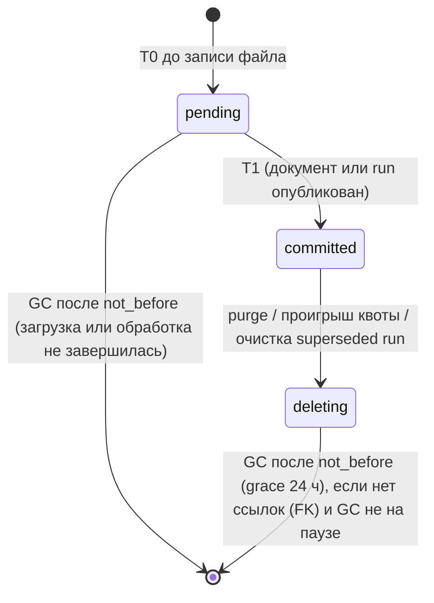

GC — часть sweeper worker'а. Работает пакетами по 100 записей и идемпотентен: отсутствующий файл считается удалённым. Флаг `maintenance_flags.gc_paused` приостанавливает удаление на время бэкапа (§13.5). Отдельно GC удаляет файлы во временном каталоге старше 24 ч. Файл на диске без записи в `blob_objects` — аномалия: `verify-storage` сообщает о нём, удаление только в режиме `--repair`.

### 6.3. Квоты и место на диске

- `workspace_usage` атомарно резервируется при финализации загрузки (I-17). Счётчики уменьшаются при soft delete документа (место освобождается для пользователя сразу, физически — после purge).
- Если свободного места на томе `blobs` меньше `FINDOCS_MIN_FREE_DISK_GB` (5), загрузка отклоняется `507 insufficient_storage`; метрика и предупреждение в логах.
- Извлечённый текст ограничен 5 млн символов (`content_too_large`), распакованный DOCX — §7.4.

---

## 7. Обработка документов

### 7.1. Pipeline и статусы

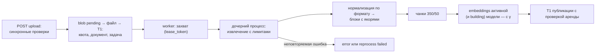

Синхронные и асинхронные проверки, коды ошибок и статусы для UI — `mvp2.0_contracts.md` §5 и §8.

**Доступность документа для поиска** (B-04):

- `status` описывает первичную обработку: `ready` ⇔ есть активный run (I-8).
- Повторная обработка не снимает `ready`: она отражается в `reprocess_state` (`queued/running/failed`). Поиск идёт по старому `active_run_id` до атомарного переключения в T1 публикации. Неудачная повторная обработка оставляет старый run активным (`reprocess_state='failed'`, `reprocess_error_code`).
- Первичная обработка, исчерпавшая попытки → `status='error'`.

| Инкремент | Что достаточно для `ready` | Ретриверы |
|---|---|---|
| α, β (без `0004`) | опубликованный run с блоками и чанками (`tsv` строится автоматически) | `lexical`, `fts` |
| γ (есть активная embedding-модель) | плюс векторы всех чанков run для активной модели (и для `building`, если идёт переиндексация) — в той же транзакции публикации | `lexical`, `fts`, `vector`, `hybrid` |

Если embedding-адаптер недоступен при обработке, это повторяемая ошибка: задача ждёт backoff, run без векторов не публикуется. Так поиск не теряет документы молча. Если недоступно вычисление вектора **запроса**, поиск идёт по FTS со строгим тем же scope, а в `meta.degraded=true` и в метрику пишется отметка о деградации (§8.3).

### 7.2. Нормализация и координаты (T-07)

| Формат | Извлечённый текст run (`extracted.txt`) | Координаты |
|---|---|---|
| TXT | декодированный оригинал (`utf-8-sig`, BOM снимается — как `decode_txt` сейчас). **Без** NFC и удаления символов | совпадают с v0.2 (ADR-010) |
| PDF | текст страниц в порядке извлечения → NFC → удаление управляющих символов, кроме `\n` и `\t` → блоки через `\n\n` | Python code points в нормализованном тексте |
| DOCX | абзацы и строки таблиц тела документа → NFC → удаление управляющих символов → блоки через `\n\n` | то же |

- Блок PDF не пересекает границу страницы, поэтому у каждого чанка и источника ровно одна страница.
- Строка таблицы сериализуется как `Заголовок1: значение | Заголовок2: значение`. Цитата из таблицы — подстрока этой сериализации; пользователь сверяет её с оригиналом по `location` (страница, таблица, строка).
- `block_id`, `chunk_id` = `UUID5(run_id, position)`.
- SRC-01 проверяет цитату по тексту **её** run, а не активного.

### 7.3. Форматы и границы извлечения (T-08)

| Формат | Библиотека | Извлекается | Не извлекается (явно) |
|---|---|---|---|
| PDF | `pdfplumber` (MIT) + `pypdf` (BSD) для шифрования и числа страниц | текстовый слой по страницам; абзацы по межстрочным интервалам; заголовки по размеру шрифта (эвристика); таблицы — `extract_tables()` в пределах её возможностей | OCR; изображения и формулы; гарантированный порядок чтения для многоколоночной вёрстки; аннотации, вложения, JavaScript |
| DOCX | `python-docx` (MIT) | абзацы тела, заголовки (путь разделов), списки, таблицы верхнего уровня (текст вложенных таблиц входит в ячейку) | колонтитулы, сноски, комментарии, надписи (text box), изображения, внедрённые объекты → предупреждение `unsupported_elements_skipped` |

PyMuPDF точнее восстанавливает порядок чтения, но распространяется под AGPL-3.0. Использовать его можно только после решения по лицензии (open, если `pdfplumber` не пройдёт контрольный набор).

**Классификация PDF по страницам:** для каждой страницы считаются непробельные символы текстового слоя и признак наличия изображений.

| Ситуация | Результат |
|---|---|
| Текста нет ни на одной странице, изображения есть | `error` / `pdf_no_text_layer` |
| Текста нет ни на одной странице, изображений нет | `error` / `empty_document` |
| На части страниц текста нет, изображения есть | `ready` + предупреждение `pages_without_text: [номера]`; UI предупреждает, что ответы по этим страницам невозможны |
| Короткие страницы с текстом | обычная обработка (порогов «доля коротких страниц» нет) |

Пороги — эвристика, проверяется на фикстурах QA (DOC-04, DOC-05) и не считается гарантией.

### 7.4. Лимиты (proposed, конфигурируемые, калибруются QA)

| Параметр | TXT | PDF | DOCX |
|---|---|---|---|
| Размер файла | 10 МиБ | 50 МиБ | 20 МиБ |
| Страниц / записей ZIP | — | 500 | ≤ 2000 записей |
| Распакованный размер / коэффициент сжатия | — | — | ≤ 200 МиБ / ≤ 100 |
| Время дочернего процесса | 30 с | 180 с | 60 с |
| Память дочернего процесса (`RLIMIT_AS`) | 512 МиБ | 1 ГиБ | 1 ГиБ |
| Извлечённый текст | 5 млн символов | 5 млн | 5 млн |
| Результат по pipe | 64 МиБ JSON | | |
| Документов / объём на пространство | 500 / 2 ГиБ | | |

### 7.5. Синхронная проверка загрузки

Подробно — `mvp2.0_contracts.md` §8. Multipart читается потоково (`python-multipart`, `max_part_size`). Caddy ограничивает тело (`request_body max_size` = лимит формата + 1 МиБ), но файл целиком в памяти не буферизуется.

### 7.6. Изоляция парсинга (T-03): что есть и чего нет

| Мера | Есть | Чего не даёт |
|---|---|---|
| Определение типа по сигнатуре, проверка ZIP до парсинга (записи, размер, коэффициент, пути с `..` и абсолютные, `vbaProject.bin`) | да | — |
| Дочерний процесс (`multiprocessing` spawn) с `RLIMIT_AS`, `RLIMIT_CPU`, `RLIMIT_NOFILE`, жёстким таймаутом и `SIGKILL` | да, только Linux (worker всегда в Linux-контейнере) | не песочница: процесс видит файловую систему и сеть контейнера |
| Пустое окружение дочернего процесса (без DSN, секретов, токенов); рабочий каталог — временный; на вход — только путь к одному файлу | да | — |
| Контейнер worker в сети `internal` без выхода в интернет | да | доступ к PostgreSQL и Ollama внутри сети остаётся |
| Результат — JSON по pipe с лимитом размера и проверкой схемы в родительском процессе | да | — |
| XML DOCX без внешних сущностей (`python-docx` использует `lxml` с `resolve_entities=False`) — проверяется тестом с XXE-файлом | да | — |
| Отдельный контейнер-парсер без сети и секретов | **нет в MVP 2.0** | рекомендуется перед открытием сервиса внешним пользователям |

Тесты (M10): зависание, превышение памяти, падение дочернего процесса, XXE, отсутствие сетевых обращений (сеть контейнера в тесте отключена), успешная обработка следующего документа.

### 7.7. Очередь задач (B-05, T-02)

**Каталог задач:**

| kind | Кто ставит | dedup_key | payload | Попытки | Идемпотентность | Блокирует |
|---|---|---|---|---|---|---|
| `process_document` | загрузка, reprocess | `process:<doc>` | `{"mode":"initial"\|"reprocess"}` | 3 (`processing_timeout` — 2) | публикация условна (аренда + `deleted_at`); run на попытку `UNIQUE(job_id, job_attempt)` | строку документа в T1 |
| `embed_backfill` | `admin reindex --model` | `embed:<model>:<doc>` | `{"model_id","run_id"}` | 3 | `INSERT ... ON CONFLICT DO NOTHING`; пропуск, если run уже не активен | строки моделей `FOR SHARE` |
| `purge_document` | удаление документа | `purge_doc:<doc>` | — | 5 | повтор над отсутствующими строками и файлами — no-op | — |
| `purge_workspace` | sweeper после `delete_after`, удаление аккаунта | `purge_ws:<ws>` | — | 5 | то же | строку пространства |

**Плановые операции sweeper** (не задачи, раз в минуту, пакетами, идемпотентны): reaper аренды; `pending`-ответы старше таймаута; GC файлов; superseded runs старше 30 дней; векторы `retired`-моделей старше 24 ч; истёкшие сессии, токены и приглашения старше 30 дней; аудит старше 180 дней; строки `auth_throttle` старше суток; постановка `purge_workspace` для пространств с прошедшим `delete_after`.

**Fencing.** Каждый захват генерирует новый `lease_token`; номер попытки `attempts` растёт.

| Операция | Условие |
|---|---|
| Захват | `UPDATE ... WHERE id = (SELECT ... FOR UPDATE SKIP LOCKED)` → новый `lease_token`, `lease_until = now() + 10 мин` |
| Heartbeat (раз в 60 с) | `WHERE id AND lease_token AND status='running'`; 0 строк → worker прекращает работу, ничего не публикует |
| Публикация / fail | первым шагом T1: `SELECT ... WHERE id AND lease_token AND status='running' AND lease_until > now() FOR UPDATE`; нет строки → откат T1 |
| Reaper | `running` и `lease_until < now()` → `queued` с backoff 30 с · 4^(n−1) (30 с, 2 мин, 8 мин) или `failed` при исчерпании |
| Отмена (удаление документа) | `queued` → `cancelled` сразу; для `running` — `cancel_requested=true`, worker проверяет при heartbeat, публикация всё равно отклоняется по `deleted_at` |

Reaper и публикация взаимно исключаются блокировкой строки задачи: если публикация успела взять `FOR UPDATE`, reaper после её коммита видит `succeeded` и пропускает задачу. Сценарий «worker A потерял аренду, B захватил, A вернулся» проверен в `sql/tests/50_queries_jobs.sql`.

**Конечные состояния при исчерпании попыток:** документ без активного run → `status='error'`; документ с активным run (повторная обработка) → остаётся `ready`, `reprocess_state='failed'`. Задачи purge при исчерпании → `failed` + предупреждение в метриках, повтор — через admin-CLI.

### 7.8. Предпросмотр документов (решение №12)

Контракт, режимы, безопасность и сценарии — `mvp2.0_contracts.md` §11. Архитектурно предпросмотр **не создаёт новых хранилищ и форматов**:

- **Текстовый режим** (TXT, DOCX, PDF) читает `document_blocks` нужного run. Координаты блоков и источников совпадают, поэтому переход к абзацу и подсветка цитаты точные. Запросы: блоки run по `position` (индекс `document_blocks_pos_uq`), страница PDF — по `anchor->>'page'` внутри run; оглавление — блоки `heading`.
- **Режим оригинала PDF** рисуется во frontend (PDF.js) из `GET .../original` с поддержкой `Range` (`BlobStorage.open_range`). Сервер PDF не рендерит и не конвертирует.
- DOCX «как в Word» не отображается: перевод недоверенного DOCX в HTML внутри приложения — поверхность XSS. Это возможное улучшение после отдельного ревью.
- Superseded run хранится 30 дней (§8.5) — этим ограничен предпросмотр по старым источникам.

---

## 8. Поиск и RAG

### 8.1. Scope

`ScopeResolver.resolve(ctx, scope)` → `ResolvedScope = [(document_id, active_run_id)]` одним запросом под RLS с явным `workspace_id`. Семантика и ошибки — `mvp2.0_contracts.md` §6. Ретриверы обязаны использовать `ResolvedScope` в `WHERE`.

### 8.2. Ретриверы

| Ретривер | Реализация | Роль |
|---|---|---|
| `lexical` | существующий `LexicalRetriever` на чанках `ResolvedScope` | точка отсчёта (baseline), обязательно сохраняется |
| `fts` | `chunks.tsv @@ fts_or_query(:question)`, ранжирование `ts_rank_cd` | лексика и морфология в БД |
| `vector` | точное косинусное расстояние в пределах scope | перефразирования |
| `hybrid` | RRF по `fts` и `vector` → фильтры доказательности → соседние чанки → dedup → `TOP_K` | целевой кандидат, выбор по замерам |

**FTS без сборки синтаксиса из текста пользователя.** Функция `fts_or_query` получает лексемы из `to_tsvector('russian', вопрос)` и объединяет их через `plainto_tsquery` и оператор `||`. Операторы tsquery в тексте вопроса не интерпретируются. Если в вопросе одни стоп-слова, функция возвращает `NULL`, и FTS-ветка пропускается (тест в `50_queries_jobs.sql`).

```sql
WITH scope AS (SELECT * FROM unnest(:doc_ids::uuid[], :run_ids::uuid[]) AS s(document_id, run_id)),
     q AS (SELECT fts_or_query(:question) AS q)
SELECT c.id, c.document_id, c.run_id, ts_rank_cd(c.tsv, q.q) AS score
FROM chunks c JOIN scope s ON s.document_id = c.document_id AND s.run_id = c.run_id, q
WHERE c.workspace_id = :workspace_id AND q.q IS NOT NULL AND c.tsv @@ q.q
ORDER BY score DESC, c.id
LIMIT 30;
```

**Векторный запрос.** SQL выбирается из фиксированного словаря по размерности активной модели (`{384, 768, 1024}`), из данных не собирается; метрика — только cosine. Перед запросом вектор вопроса проверяется: размерность совпадает с моделью, нет NaN/Inf, норма > 0.

```sql
-- шаблон для dims ∈ {384, 768, 1024}; :model_id — активная модель, зафиксированная в начале запроса
WITH scope AS (SELECT * FROM unnest(:doc_ids::uuid[], :run_ids::uuid[]) AS s(document_id, run_id))
SELECT e.chunk_id, e.document_id, 1 - (e.embedding::vector(384) <=> :qvec::vector(384)) AS score
FROM chunk_embeddings e JOIN scope s ON s.document_id = e.document_id AND s.run_id = e.run_id
WHERE e.model_id = :model_id AND e.workspace_id = :workspace_id
ORDER BY e.embedding::vector(384) <=> :qvec::vector(384), e.chunk_id
LIMIT 30;
```

**Без ANN-индекса.** При фильтре по scope HNSW сначала берёт ближайших соседей по всей таблице, а потом фильтрует: релевантные чанки из scope могут потеряться. Точный перебор в пределах scope корректен по определению. Оценка «десятки миллисекунд на пространство до ~100 тыс. чанков» — **гипотеза до замера** (NFR-PERF). HNSW с `hnsw.iterative_scan` (pgvector ≥ 0.8) добавляется отдельной миграцией, только если p95 этого потребует.

**RRF и пороги.** `score = Σ 1/(60 + rank_i)`, порядок при равенстве — по `chunk_id`. Пороги покрытия ADR-018 (`MIN_COVERAGE=0.6` и др.) на hybrid **не переносятся**: пороги и `TOP_K` подбираются на настроечной части контрольного набора (`security-qa.md` §6).

### 8.3. Деградация

Если вычислить вектор запроса не удалось (адаптер недоступен), hybrid выполняется только по FTS с тем же `ResolvedScope`; `meta.degraded=true`, метрика `retrieval_degraded_total`. Качество в режиме деградации оценивается отдельно (RAG-16). Расширения scope и подмены документов нет ни в каком fallback.

### 8.4. Embeddings и смена модели

| Кандидат | Размерность | Запуск | Плюсы | Минусы |
|---|---|---|---|---|
| `intfloat/multilingual-e5-small` | 384 | sentence-transformers (CPU) | токенизатор уже закреплён, чанк 350 токенов укладывается в 512 | слабее на перефразированиях |
| `intfloat/multilingual-e5-base` | 768 | sentence-transformers | лучше small | вдвое больше памяти и времени |
| `BAAI/bge-m3` | 1024 | Ollama `/api/embed` или sentence-transformers | сильная мультиязычная модель | 568 M параметров; на одном сервере конкурирует с LLM |

Выбор зависит от характеристик демо-сервера (решение не принято). Нужен замер совместной работы LLM и worker по памяти и задержке (NFR-PERF), до этого — `e5-small` как стартовый кандидат.

Жизненный цикл модели: `candidate → building → active → retired`.

1. `building`: admin-CLI ставит задачи `embed_backfill` для всех активных run. Публикации новых run в это время считают векторы и для `active`, и для `building` модели (под `FOR SHARE`).
2. `activate_embedding_model(id)` под `FOR UPDATE` проверяет полное покрытие всех активных run и атомарно переключает модели (тест `30_embeddings.sql`).
3. Запрос фиксирует `model_id` в начале. Начатые до переключения запросы дорабатывают со старой моделью, её векторы удаляются sweeper'ом через 24 ч после `retired`.
4. `MockEmbedding` разрешён только при `FINDOCS_ENV` ∈ `dev`, `test` (проверка конфигурации на старте).

### 8.5. Переиндексация при смене парсера или чанкинга

Новый `pipeline_version` → `admin reindex --pipeline-version N` ставит `process_document` (`mode=reprocess`) для всех документов. Документы остаются `ready` по старым run до переключения. Старые run → `superseded` и хранятся 30 дней ради контекста в источниках `reprocessed`.

---

## 9. Чат

### 9.1. Сохранение и генерация

Контракт и таблица повторов — `mvp2.0_contracts.md` §7.

- **T1:** `chats FOR UPDATE`, проверка архивности, `next_seq += 2`, вопрос (`client_message_id`, `request_fingerprint`, `scope`, `use_history`) + ответ `pending` с `generation_attempt`. Блокировки не удерживаются на время LLM.
- **Генерация:** разрешение scope (заново и с текущими правами при повторе после `failed`), отбор истории (§9.2), поиск, LLM, серверная проверка (§10).
- **T2** с контекстом пользователя:
  1. `SELECT 1 FROM documents WHERE id = ANY(:context_doc_ids) AND deleted_at IS NULL FOR SHARE` — число строк должно совпасть;
  2. проверка, что ответы истории, использованные в prompt, не скрыты и их документы не удалены;
  3. `UPDATE ... WHERE generation_attempt = :token AND generation_status = 'pending'`;
  4. `message_context_documents` → `message_sources` (триггеры проверяют происхождение, I-4, I-5).

  Если условие 1 или 2 не выполнено → ответ `failed` с кодом `context_changed`; текст сгенерированного ответа **не сохраняется и не отправляется** клиенту. Если в п. 3 затронуто 0 строк, попытка устарела и результат отбрасывается.
- **Sweeper:** `pending` старше `FINDOCS_LLM_TIMEOUT_SECONDS + 60 с` → `failed/generation_interrupted`.
- **Заголовок** (minor-дефект №1 MVP 1.0): `default` → `auto` (первые 60 символов первого вопроса по границе слова) → `user` после ручного переименования.

### 9.2. История диалога (решение №13)

| Правило | Значение |
|---|---|
| Включение | `use_history` из запроса (обязательное поле; входит в fingerprint); `FINDOCS_CHAT_HISTORY_TURNS=0` отключает глобально |
| Кандидаты | до 2 последних пар этого чата со статусом `completed` и `answered` или `partial` |
| Отбор пары | пара допускается, только если **все** документы её контекста (`message_context_documents`) входят в текущий `ResolvedScope` и не удалены, и ответ не скрыт (`content_redacted_at IS NULL`) |
| Что идёт в поиск | текущий вопрос; если он короче 6 значимых слов или содержит анафору, добавляется **предыдущий вопрос** допущенной пары (не ответ модели) |
| Что идёт в prompt | допущенные пары в блоке «История диалога — не является источником фактов», ≤ 1500 символов |
| Откуда факты | только из фрагментов текущего поиска; проверки §10 не меняются |
| T2 | повторная проверка документов допущенных пар (§9.1, п. 2) |

### 9.3. Производные данные удалённых документов (решение №14)

Выбран вариант **скрытия ответа целиком**. Ответ, при генерации которого модели передавались фрагменты удалённого документа, скрывается вместе со всеми цитатами. Вопрос пользователя и порядок сообщений остаются, вместо ответа UI показывает уведомление. Полная таблица поведения (чтение, повтор `POST`, удаление во время генерации, конкуренция с T2, история, окончательная очистка) — `mvp2.0_contracts.md` §7.4.

Архитектурные опоры:

- `message_context_documents` хранит **все** документы, фрагменты которых переданы LLM (а не только показанные источники). По этой таблице определяется скрытие, она переживает очистку (только ID).
- Проверка выполняется при чтении, поэтому скрытие наступает сразу после `soft_delete`, без ожидания `purge_document`.
- `purge_document` физически стирает текст ответа и цитаты (`content_redacted_at`, `redacted_at`). Повторное чтение даёт тот же результат.
- Скрытые ответы исключаются из истории (§9.2) и не участвуют в уточнении поискового запроса.
- По старым ссылкам недоступны **все** источники скрытого ответа, включая источники из документов, которые не удалялись (`410 source_unavailable`): иначе по ним можно было бы восстановить фрагменты скрытого ответа.
- Удаление не распространяется на скачанные копии и на бэкапы до ротации (§5.6).

### 9.4. Статусы ответа

| Статус | Значение | Условие |
|---|---|---|
| `answered` | существенные части вопроса подтверждены | модель вернула `supported="full"`, `used_fragments` ⊆ переданных, серверные проверки §10 пройдены, ≥ 1 источник |
| `partial` | подтверждена часть; ответ явно говорит, чего нет | только при `FINDOCS_ALLOW_PARTIAL=true` после отдельного QA (open №17); иначе трактуется как `insufficient_info` |
| `insufficient_info` | доказательств нет | 0 источников, фиксированный текст отказа |

Несогласованный ответ модели (`supported="full"` при пустых `used_fragments`, идентификаторы вне переданных, невалидный JSON) → `insufficient_info` и метрика `llm_inconsistent_total`.

---

## 10. Генерация и prompt injection

- Контракт `LLMAdapter` меняется: `GenerationRequest(question, fragments, history=[], allow_partial=False)` вместо отдельных аргументов (`mvp2.0_contracts.md` §14). У `MockLLM` и существующих тестов прежнее поведение при `history=[]`.
- Prompt: системные правила → блок истории → фрагменты в разделителях `<<<FRAGMENT F3 | report.pdf | стр. 4>>> … <<<END F3>>>` (маркеры внутри текста документа экранируются) → вопрос.
- Модель возвращает JSON `{supported, answer, used_fragments}`. Источники строит сервер **только из `used_fragments`**, прошедших проверки. Это заменяет правило «цитата ≥ 40 символов» для второстепенных источников (minor-дефект №3) — фильтр по смыслу, а не по длине.
- Серверные проверки опоры: числа, даты, проценты и суммы из ответа должны встречаться в использованных фрагментах (расширение `completeness.py`). Это **не** доказательство подтверждённости всех утверждений: полная проверка смысла не обещается, качество измеряется на контрольном наборе (`security-qa.md` §6).
- Документ не может изменить scope, роль, модель или системные правила: они вычислены до вызова LLM. У модели нет инструментов и сети.
- Устойчивость к injection подтверждается прогонами реальной Ollama на фикстурах (TXT/PDF/DOCX) плюс mock-тестами границ scope. Ни то, ни другое не доказывает устойчивость к любой атаке.
- Холодный старт: прогрев модели при старте (`keep_alive`); таймаут клиента Ollama 90 с, таймаут proxy на `/api/v1/.../messages` — 120 с; семафор генераций (§13.4).
- Streaming в MVP 2.0 не входит.

---

## 11. Sequence-диаграммы

### 11.1. Регистрация → личное пространство

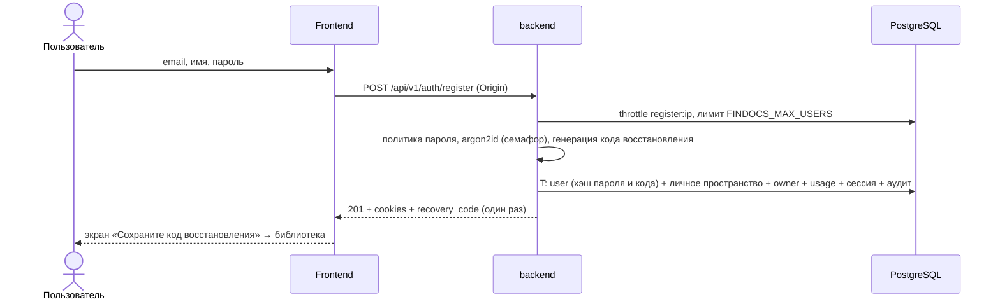

### 11.2. Загрузка → обработка → индекс

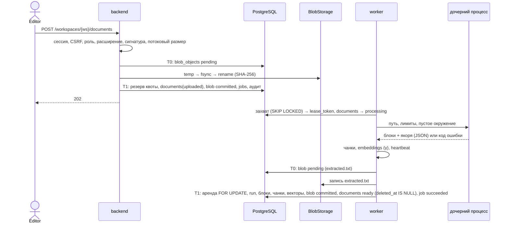

### 11.3. Вопрос

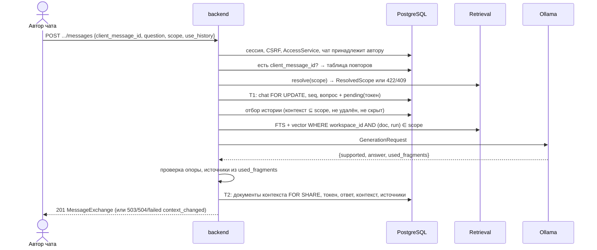

### 11.4. Удаление документа

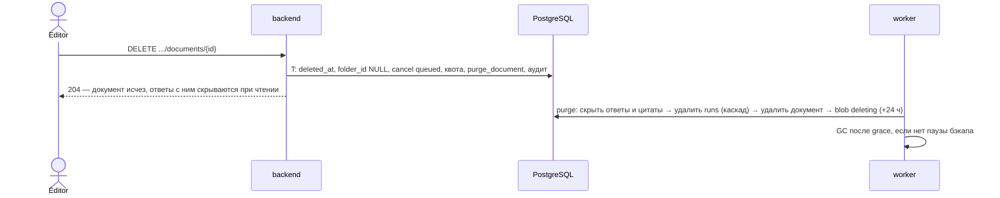

---

## 12. Границы доверия

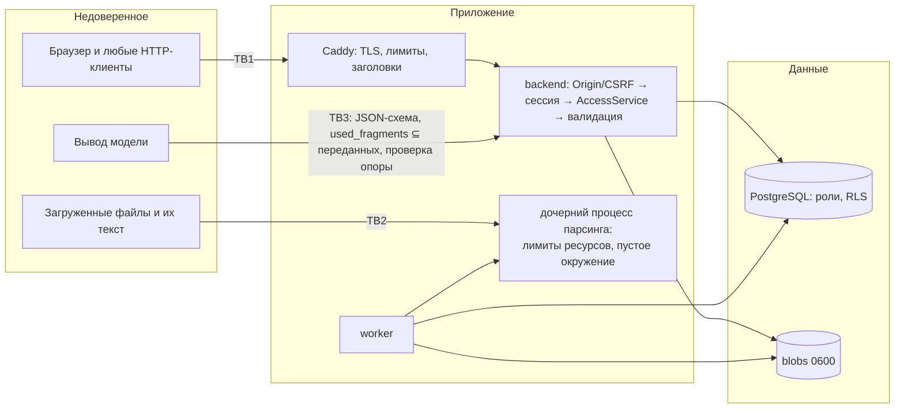

Точки обязательной авторизации: каждый маршрут `api/v1` (`require_access`, тест-«сторож»); `ScopeResolver`; отдача оригинала; чтение сообщений и источников (с повторной проверкой удаления); T2; admin-CLI (только локально на сервере, под отдельной ролью БД).

---

## 13. Эксплуатация

### 13.1. Стек и версии (решение №8, ADR-021)

| Компонент | Версия | Закрепление |
|---|---|---|
| PostgreSQL | 16.x | образ `pgvector/pgvector:0.8.0-pg16` по digest (`sql/README.md`) |
| pgvector | 0.8.0 | там же; схема проверена на 0.6.0, прогон на 0.8.0 обязателен в A1 |
| SQLAlchemy / Alembic / psycopg | 2.0.x / 1.14.x / 3.2.x | `requirements.txt` с точными версиями, как сейчас |
| argon2-cffi | 23.x | — |
| pdfplumber / pypdf / python-docx | закрепляются в M10–M11 | — |
| Caddy | 2.8.x | digest образа |
| Ollama | версия фиксируется в runbook стенда | модели — по тегу и digest (`ollama show --modelfile`) |

### 13.2. Порядок миграций и включения функций (B-11)

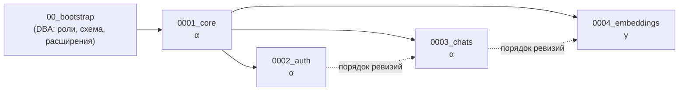

- RLS, политики и права создаются вместе с таблицей в той же ревизии. Отдельной «миграции RLS» нет.
- Каждая ревизия имеет `downgrade`. CI выполняет `upgrade → downgrade → upgrade` на пустой БД и `upgrade` на заполненной фикстурами БД предыдущей ревизии.
- Роли, схема и расширения — `00_bootstrap.sql`, выполняет администратор. Alembic их не создаёт и не откатывает.
- `run_tests.sh` воспроизводит именно этот порядок: после каждой миграции прогоняются её тесты.

### 13.3. Совместимый слой в начале α (A2/M2)

1. **M2** (Максим): `ProcessingResult` v2 (run, блоки с якорями, извлечённый текст) для TXT поверх **текущего** файлового хранилища. Golden-тесты: TXT-координаты и цитаты M01–M20 не меняются.
2. **A2** (Артём): `PostgresDocumentRepository` и `PostgresProcessingRepository` реализуют **новые** протоколы (`mvp2.0_contracts.md` §14). Параметризованные тесты гоняются против обеих реализаций — файловой и PostgreSQL.
3. **A3 + M3**: очередь и worker заменяют `BackgroundTasks`.
4. Промежуточная точка α-1: вертикаль TXT (загрузка → ready → вопрос → цитата) работает на PostgreSQL в режиме `legacy_single_user` (только dev/test), все тесты MVP 1.0 зелёные. Дальше α продолжается аккаунтами, API v1 и чатами (`product-requirements.md` §3.2).

Старый Protocol на SQL не реализуется — двойной работы нет.

### 13.4. Конфигурация и роли процессов (T-14)

| Переменная | Где | Назначение |
|---|---|---|
| `FINDOCS_ENV` | все | `dev`, `test`, `stand`; в `stand` — запреты §3.3 |
| `FINDOCS_DATABASE_URL` | backend | DSN роли `findocs_app` |
| `FINDOCS_WORKER_DATABASE_URL` | worker, admin-CLI | DSN роли `findocs_worker` |
| `ALEMBIC_DATABASE_URL` | job миграций | DSN `findocs_migrator` |
| `PGBACKUP_*` | контейнер backup | DSN `findocs_backup`, ключ restic |
| `FINDOCS_BLOB_DIR`, `FINDOCS_MIN_FREE_DISK_GB` | backend, worker | хранилище |
| `FINDOCS_ALLOWED_ORIGINS`, `FINDOCS_TRUSTED_PROXIES` | backend | Origin-проверка; IP клиента берётся из `X-Forwarded-For` только от адресов proxy |
| `FINDOCS_AUTH_MODE` | backend | `accounts` или `legacy_single_user` (только dev/test на переходных этапах, отдельная БД с маркером режима; удаляется в M15) |
| `FINDOCS_REGISTRATION_MODE`, `FINDOCS_MAX_USERS` | backend | `open` (по умолчанию, решение №3) или `closed`; лимит числа аккаунтов (50) — страховка на случай случайного внешнего доступа |
| `FINDOCS_SESSION_IDLE_HOURS`, `FINDOCS_SESSION_ABSOLUTE_DAYS` | backend | 12 / 7 (решение №3) |
| `FINDOCS_CURSOR_SECRET` | backend | секрет подписи курсоров (Docker secrets) |
| `FINDOCS_LLM_*` (есть), `FINDOCS_LLM_MAX_CONCURRENCY` (1) | backend | генерация |
| `FINDOCS_ARGON2_MAX_CONCURRENCY` (2) | backend | семафор хеширования: вход и регистрация не блокируют пул потоков; сверх лимита — ожидание ≤ 5 с, затем `429` |
| `FINDOCS_EMBEDDING_PROVIDER`, `FINDOCS_EMBEDDING_MODEL` | backend, worker | `mock` запрещён в `stand` |
| `FINDOCS_RETRIEVER`, `FINDOCS_CHAT_HISTORY_TURNS`, `FINDOCS_ALLOW_PARTIAL`, `FINDOCS_SEARCH_DIAGNOSTICS` | backend | поиск и чат |
| `FINDOCS_WORKSPACE_DELETE_DAYS` | worker | отсрочка удаления (7 дней, решение №4) |

Сети compose: `edge` (caddy), `internal` с `internal: true` (backend, worker, db, ollama), `backup` (backup + выход к хранилищу бэкапов). Модели Ollama загружаются один раз при подготовке стенда, отдельной командой с выходом в интернет.

### 13.5. Бэкап и восстановление (B-10)

**Процедура бэкапа** (контейнер backup, ежедневно и перед каждым обновлением с миграцией):

1. `INSERT INTO maintenance_flags('gc_paused', until = now() + 6h)` — GC перестаёт удалять файлы.
2. Открыть транзакцию `REPEATABLE READ`, выполнить `SELECT pg_export_snapshot(), pg_current_snapshot(), now()` и держать её открытой. `pg_dump -Fc --snapshot=<exported>` под ролью `findocs_backup` (BYPASSRLS + `pg_read_all_data`; дамп и восстановление проверены в `run_tests.sh`). Так время и содержимое снимка БД известны точно.
3. `restic backup` тома `blobs`. Файлы неизменяемы, удаление на паузе, поэтому всё, на что ссылается дамп, есть в снимке файлов.
4. Manifest: `{backup_id, db_snapshot (pg_snapshot), db_snapshot_at, dump_finished_at, dump_sha256, restic_snapshot_id, alembic_revision, app_version}` — вместе с бэкапом.
5. Закрыть транзакцию снимка, снять паузу GC. Если бэкап упал, пауза истечёт сама по `until`.

**Хранение:** 14 ежедневных + 4 недельных. Шифрование restic; ключ хранится отдельно от машины с данными. Удалённые данные остаются в бэкапах до ротации (до 35 дней).

**Журнал удалений и гарантии восстановления** (доработка 5; реализация — Артём):

- Каждая операция удаления и **отмены удаления** записывает строку в `deletion_journal` в той же транзакции (I-24):
  - soft delete документа;
  - постановка пространства на удаление, его восстановление владельцем, окончательная очистка;
  - обезличивание аккаунта;
  - исключение участника, удаление чата.
- В строке: `txid = pg_current_xact_id()`, тип и ID объекта, действие и **версия объекта после изменения** (`entity_version`, например `workspaces.version`, растущая под блокировкой строки). Для `pending_deletion` дополнительно хранится `delete_after`. Эталон `sql/` содержит минимальную таблицу; поля `entity_version` и `details` Артём добавляет при реализации (A6/A9).
- Worker выгружает новые строки во **внешнее** хранилище, независимое от бэкапов БД: append-only файлы `deletions/YYYY-MM-DD.jsonl` с контрольными суммами. Выгрузка срабатывает в течение нескольких секунд после фиксации (`LISTEN/NOTIFY` от триггера журнала) и, кроме того, раз в минуту по таймеру. Выгруженные строки помечаются `exported_at`. Журнал хранится не меньше срока хранения бэкапов + 7 дней.

**Точка отсчёта.** Не время окончания бэкапа и не время начала дампа, а **снимок БД** из manifest. Повторно применяются ровно те записи, которые не видны в снимке: `NOT pg_visible_in_snapshot(txid, db_snapshot)` (проверено тестом `45_delete_policy.sql`). Удаление, зафиксированное во время дампа, но не попавшее в снимок, не теряется; попавшее в снимок не применяется дважды. Для записей без `txid` — резервное правило `occurred_at ≥ db_snapshot_at − 10 мин` (больше любой транзакции удаления); повторное применение идемпотентно.

**Порядок и отмена удаления пространства.** Записи по одному объекту применяются в порядке `entity_version`, а не `txid` или времени: порядок фиксации транзакций может отличаться от порядка выдачи `txid`, а версия объекта меняется строго последовательно под блокировкой строки. Для каждого объекта берётся **последнее** состояние из записей, не видимых в снимке:

| Последняя запись после снимка | Что делает повторное применение |
|---|---|
| `pending_deletion` | пространство → `pending_deletion` с исходным `delete_after`; если срок уже прошёл — окончательная очистка |
| `restored` (удаление отменено владельцем) | пространство → `active`, даже если в снимке оно было `pending_deletion`; ранее поставленная очистка не выполняется |
| `purged` | окончательная очистка |
| документ `soft_deleted`, аккаунт `anonymized`, чат `deleted`, участник `removed` | операция необратима, применяется как есть |

Это же правило защищает от обратной ошибки: восстановление не удаляет пространство, удаление которого владелец успел отменить после бэкапа.

**Гарантии и их границы:**

| Что | Гарантия |
|---|---|
| Удаления, зафиксированные **до** снимка БД | уже в снимке, повторно не применяются |
| Удаления и отмены удаления пространств **после** снимка, которые успели попасть во внешний журнал | применяются; удалённое не возвращается, отменённое удаление не выполняется |
| Удаления в последние секунды перед потерей БД, **не успевшие выгрузиться** | гарантии нет — окно равно задержке выгрузки (цель — секунды, порог тревоги — 5 мин). Снижение риска: перед восстановлением, если исходная БД ещё читается (логическая ошибка, а не потеря диска), выполняется `admin export-deletions --from-db` — выгрузка оставшихся строк журнала; отчёт восстановления указывает время последней выгруженной записи и окно неопределённости. Метрика `deletion_journal_export_lag_seconds`: при превышении 5 мин — предупреждение администратору |
| Созданные после снимка данные (документы, сообщения, повторные вступления в пространство) | теряются (RPO данных — до 24 ч); журнал удалений их не восстанавливает |
| Повреждение или подмена внешнего журнала | контрольные суммы файлов и непрерывность `id` проверяются перед применением; при разрыве восстановление останавливается до решения администратора |
| Сервис во время восстановления | не принимает запросы, пока не применён журнал (флаг `restore_in_progress`) |

**Восстановление (runbook; реализация и проверка — Артём):**

1. Остановить `backend` и `worker`. Выставить флаг `restore_in_progress` (файл в томе данных): пока он стоит, backend не принимает запросы (`/api/ready` = 503).
2. Выбрать **пару из manifest** (не «ближайший снимок»).
3. `00_bootstrap.sql` на пустой БД → `DROP SCHEMA findocs` → `pg_restore --exit-on-error` дампа из manifest.
4. `restic restore <restic_snapshot_id>` в `FINDOCS_BLOB_DIR`.
5. Если исходная БД доступна для чтения — `admin export-deletions --from-db`. Затем `python -m app.admin reapply-deletions --manifest <manifest>` по внешнему журналу: проверка целостности журнала → записи, не видимые в `db_snapshot`, по объектам в порядке `entity_version` → отчёт (применено, пропущено как отсутствующее, окно неопределённости).
6. `python -m app.admin verify-storage --check`: у каждого неудалённого документа есть оригинал с верным SHA-256; у каждого активного run есть `extracted.txt` с верным SHA-256; нет ссылок на `deleting`. Режим `--repair` отдельный: документ без оригинала → `error/original_missing`; run без `extracted.txt` → повторная обработка.
7. `alembic current` совпадает с manifest → снять флаг → запуск → `/api/ready` = 200 → smoke (вход, список, M01, цитата; удалённый после бэкапа тестовый документ не виден).
8. Учения на чистой машине — ежемесячно и обязательно перед релизом (gate G5).

**RPO/RTO:** при ежедневном бэкапе RPO — до 24 ч (изменения за сутки могут быть потеряны). RTO фиксируется по результату первого учения. Целевые значения не объявляются до замера.

### 13.6. Наблюдаемость

- JSON-логи: `ts, level, request_id, route` (**шаблон маршрута**, не сырой путь), `method, status, duration_ms, user_id, workspace_id, error_code`. Политика запрещённых полей — `security-qa.md` §4.9.
- `/api/health` → 200 `{"status":"ok"}`. `/api/ready` → 200 `ok`; 200 `degraded`, если Ollama недоступна; 503 `fail`, если недоступны БД, миграции или хранилище. Без версий, хостов и текстов исключений.
- Метрики (`prometheus-client`, endpoint только во внутренней сети): RPS, ошибки и latency по шаблонам маршрутов; latency retrieval и LLM; длина очереди и возраст старейшей задачи; `failed` по `error_code`; `retrieval_degraded_total`; `llm_inconsistent_total`; свободное место. Отдельный стек мониторинга в MVP 2.0 не разворачивается.

---

## 14. MVP 1.0 и данные

- **Перенос данных MVP 1.0 не выполняется** (решение №9). MVP 2.0 стартует с чистой БД; `import-legacy`, отчёты импорта и сценарий переключения из архитектуры, плана PR и критериев приёмки исключены.
- MVP 1.0 остаётся самостоятельной стабильной версией: её код в git (тег `mvp-1.0` на `8120430`) и инструкции запуска сохраняются, MVP 2.0 их не меняет.
- Тестовые документы, контрольные вопросы и QA-материалы MVP 1.0 (`qa/test_data`, `qa/demo`, `qa/reports`) используются для регрессии MVP 2.0 (`security-qa.md` §7.2): они загружаются в MVP 2.0 как обычные документы тестового пользователя.
- **Миграции схемы БД обязательны** (§13.2): Alembic, `upgrade → downgrade → upgrade`, проверка на заполненной фикстурами БД предыдущей ревизии.
- Legacy-маршруты MVP 1.0 внутри кода 2.0 — только переходный режим разработки (`mvp2.0_contracts.md` §12), удаляются в M15.

---

## 15. Архитектурные решения

Все решения — в `docs/mvp2.0/decisions.md` (ADR-021…040) со статусами `approved` / `proposed` / `open` и ссылками на заменяемые и дополняемые ADR MVP 1.0. Нумерация продолжает `docs/mvp1.0/decisions.md`.

---

## 16. Изменения в существующих файлах

| Файл / модуль | Изменение | Уверенность |
|---|---|---|
| `backend/app/main.py` | middleware (request_id, Origin/CSRF, заголовки), роутеры `api/v1`, префикс `/api`; legacy-роутеры только в `legacy_single_user` | высокая |
| `backend/app/core/config.py` | переменные §13.4, запреты для `stand` | высокая |
| `backend/app/documents/*` | новые модели и протоколы (`mvp2.0_contracts.md` §14); `LocalFileDocumentRepository` остаётся только для legacy-режима и тестов M2 и удаляется в M15 | высокая |
| `backend/app/processing/models.py`, `processor.py` | `ProcessingResult` v2, якоря, извлечённый текст | высокая |
| `backend/app/processing/txt.py`, `chunking.py`, `tokenizer.py` | алгоритм не меняется; сообщения ошибок → коды + русский текст | высокая |
| `backend/app/retrieval/lexical.py` | вход — чанки `ResolvedScope` | средняя |
| `backend/app/chat/service.py`, `context.py`, `sources.py`, `completeness.py` | scope-объект, история, T1/T2, источники из `used_fragments`, `location` | высокая |
| `backend/app/llm/adapter.py`, `mock.py`, `ollama.py` | `GenerationRequest`, JSON с `used_fragments`, маркеры фрагментов | средняя |
| `backend/app/api/documents.py`, `chat.py`, `health.py` | legacy до M15; health → `/api/health` | высокая |
| `backend/requirements*.txt` | `sqlalchemy`, `alembic`, `psycopg[binary]`, `pgvector`, `argon2-cffi`, `pdfplumber`, `pypdf`, `python-docx`, `prometheus-client`; `sentence-transformers` — по итогам эксперимента | высокая |
| `frontend/src/types/api.ts` → `api.gen.ts` | генерация из `openapi.yaml` | высокая |
| `frontend/src/api/client.ts`, `validators.ts`, `config.ts` | `credentials: 'same-origin'`, `X-CSRF-Token`, 401/403/404/409, курсоры | высокая |
| `frontend/vite.config.ts` | proxy `/api` без rewrite | высокая |
| `frontend/src/mocks/*` | mock v1 на фикстурах `qa/contracts/fixtures` | средняя |
| `.github/workflows/*` | сервис PostgreSQL по digest, `sql/run_tests.sh`, alembic up/down/up, `oasdiff`, `openapi-typescript`, import-linter, `pip-audit`, gitleaks | высокая |
| `scripts/setup.*`, `check.*` | `docker compose up db`, загрузка embedding-модели с SHA-256 | средняя |
| `docs/mvp1.0/decisions.md` | пометки «Заменено» у ADR-011, 012, 013, 016 | высокая |
| `docs/mvp2.0/` | этот комплект + `decisions.md` + `openapi.yaml` + `sql/`; `api-security-qa.md` удаляется | — |
| `scripts/check_openapi_contract.py` | проверка контракта по инкрементам (`mvp2.0_contracts.md` §1) | — |
| `frontend/package.json` | `pdfjs-dist` (закреплённая версия) для предпросмотра | средняя |
