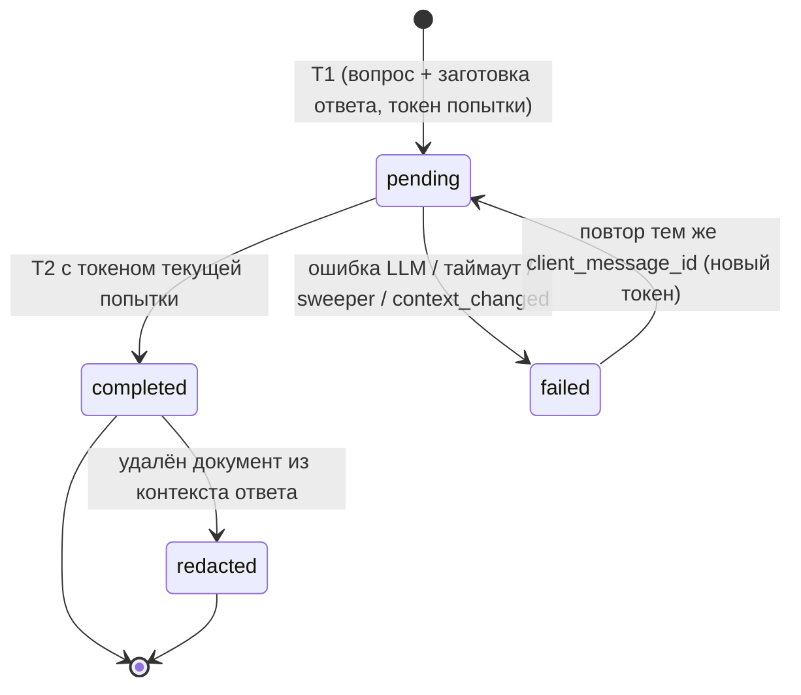
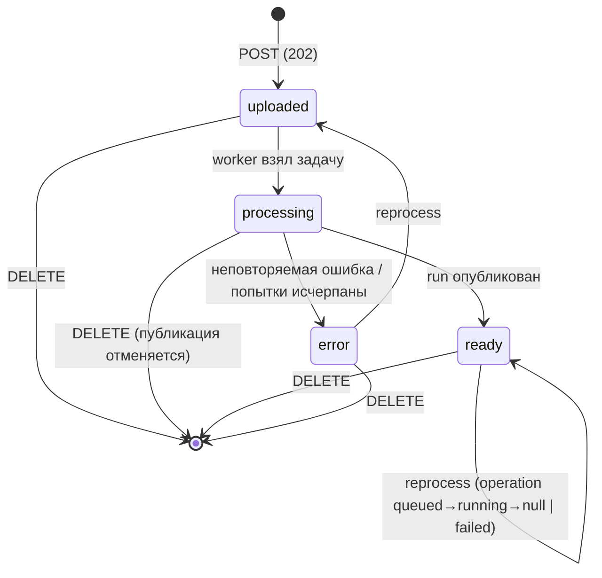

# FinDocs MVP 2.0 — Контракты

**Документ 3 из 4** комплекта MVP 2.0:

1. `product-requirements.md` — продукт, решения, команда, план.
2. `architecture2.0.md` — архитектура, модель данных, жизненные циклы, бэкапы.
3. **`mvp2.0_contracts.md`** — этот документ: правила API v1, словарь ошибок, состояния ресурсов, предпросмотр, совместимость, внутренние контракты backend.
4. `security-qa.md` — права доступа, информационная безопасность, тестирование и release gates.

Связанные артефакты:

- `openapi.yaml` — **основной машиночитаемый контракт** frontend ↔ backend (решение №15). OpenAPI 3.1, YAML: 39 путей, 54 операции, 74 схемы. У каждой операции указан инкремент `x-increment`: α — 28, β — 25, γ — 1. Проходит `openapi-spec-validator`.
- `scripts/check_openapi_contract.py` — проверка в CI с учётом инкрементов (раздел 1).
- `sql/` — эталонная схема БД и 186 воспроизводимых проверок (`architecture2.0.md` §5).
- `decisions.md` — ADR со статусами.

| Поле | Значение |
|---|---|
| Версия контракта | `1.0.0-draft.3` |
| Статус | решения №1–24 Максима учтены. Контракты замораживаются по инкрементам (раздел 13) |
| Согласуют | API — Максим и Аня; внутренние типы слоя хранения — Максим и Артём; целостность — Влад |

---

## 1. Источник истины и проверка в CI

1. Источник истины для HTTP API — `docs/mvp2.0/openapi.yaml`. Этот документ объясняет правила, которые неудобно выразить схемой. При расхождении прав `openapi.yaml`, а расхождение заводится как дефект документации.
2. Изменение замороженного контракта — только отдельным PR с меткой `contract-change`. Его одобряют Максим, Аня и Влад, затем в одном PR обновляются `openapi.yaml`, этот документ, сгенерированные типы frontend и фикстуры QA.
3. **Поэтапная проверка в CI** (PR Q1). API реализуется по инкрементам, поэтому отсутствие операций следующих инкрементов CI не роняет. Отклонение уже реализованной операции от контракта CI ловит автоматически:

| Шаг | Инструмент | Что падает |
|---|---|---|
| 1. Покрытие и форма операций | `scripts/check_openapi_contract.py --require-through $CONTRACT_REQUIRED_INCREMENT` по `app.openapi()` | маршрут под `/api` не описан в контракте; не реализована операция **завершённого** инкремента; у реализованной операции не совпадает `operationId`, набор path- и query-параметров и их обязательность, обязательность тела и media type; приложение объявляет успешный код, которого нет в контракте |
| 2. Ломающие различия схем | `oasdiff breaking <контракт, сокращённый до реализованных операций> <app.json> --fail-on ERR` | приложение требует новый параметр или поле, сужает enum запроса, удаляет обязательное поле ответа, меняет тип |
| 3. Ответы сервера против схемы | `schemathesis run <сокращённый контракт>` против тестового сервера (mock LLM, фикстуры БД), проверки `response_schema_conformance` и `status_code_conformance` | ответ не проходит схему контракта, включая лишние поля (`additionalProperties: false`) |
| 4. Frontend | `openapi-typescript` → `frontend/src/types/api.gen.ts`; сборка падает, если сгенерированный файл отличается от закоммиченного | — |
| 5. Фикстуры | каждый файл `qa/contracts/fixtures/*.json` валидируется по своей схеме | — |

- `CONTRACT_REQUIRED_INCREMENT` — переменная репозитория: `none` во время разработки α, `alpha` после закрытия α, затем `beta`, `gamma`. Её повышение — часть критерия закрытия инкремента (`product-requirements.md` §3.2).
- Операции текущего инкремента, которые ещё не реализованы, скрипт выводит списком без ошибки.
- Скрипт проверен на тестовом FastAPI-приложении: недокументированный маршрут, переименованный `operationId` и изменённые query-параметры ловятся, а legacy-маршруты вне `/api` игнорируются.
- Pydantic-модели пишутся **по** схемам `openapi.yaml`. Обратное направление (генерация контракта из кода) не используется.

---

## 2. Общие соглашения

| Правило | Значение |
|---|---|
| Маршруты | API: `/api/v1/...`. Служебные: `/api/health` (liveness), `/api/ready` (readiness). Без версий в служебных путях |
| Проксирование | Caddy и Vite передают `/api/*` в backend **без переписывания пути**. Других маршрутов backend наружу не публикует |
| Идентификаторы | публичные ресурсы — UUID в нижнем регистре. Сущности, созданные приложением, получают UUID v4. `block_id` и `chunk_id` — детерминированные UUID v5 (от `run_id` и позиции). Числовые ID (аудит, embedding-модели) наружу не отдаются, модель указывается именем |
| Время | ISO 8601, UTC, суффикс `Z`, миллисекунды (`2026-12-01T09:00:00.000Z`) |
| Кодировка | UTF-8. Имена файлов в `Content-Disposition` — по RFC 6266/5987 (`filename*=UTF-8''...`) плюс ASCII-запасной вариант |
| Тела запросов | `additionalProperties: false`: неизвестное поле → `422 validation_error` |
| Строки | пробелы по краям обрезаются для `question`, `name`, `title`, `display_name`, `filename`. Пустая после обрезки строка → `422` |
| Лимиты | JSON-тело ≤ 1 МиБ; загрузка ≤ лимит формата + 1 МиБ на multipart. Сверх лимита ответ даёт proxy или приложение, **в том же конверте ошибки** |
| Кэш | у всех ответов `/api/*` заголовок `Cache-Control: no-store` |
| Request ID | сервер генерирует `X-Request-ID` (ULID) и возвращает его в заголовке и в `error.request_id`. Клиентское значение не принимается |

### 2.1. Конверт ошибки

```json
{ "error": { "code": "scope_invalid", "message": "Некоторые документы недоступны или не существуют.",
             "details": { "invalid_document_ids": ["0f8b2c2e-3f4e-4d6a-9b1c-2a3b4c5d6e7f"] },
             "request_id": "01JDXQ4N7Z8K9M2P3Q4R5S6T7U" } }
```

Конверт одинаков для ошибок сервисов, ошибок валидации FastAPI (обработчик `RequestValidationError` → `422 validation_error`, `details.fields = [{"path": "body.scope.document_ids", "reason": "too_short"}]`), middleware (CSRF, Origin, rate limit) и proxy. Для proxy Caddy через `handle_errors` отдаёт JSON для 413, 502, 503 и 504 с кодами `payload_too_large`, `service_unavailable`, `gateway_timeout`. Текст исключения, стек, SQL и пути файлов в ответ не попадают никогда.

### 2.2. Аутентификация и CSRF по классам маршрутов

| Класс | Маршруты | Сессия | Защита от CSRF |
|---|---|---|---|
| Публичные GET | `/api/health`, `/api/ready` | нет | не нужна |
| Гостевые POST | `/v1/auth/register`, `/v1/auth/login`, `/v1/auth/password/set` | нет | `Origin` строго из `FINDOCS_ALLOWED_ORIGINS`. Если `Origin` нет или он чужой → `403 origin_not_allowed`. Если есть `Sec-Fetch-Site`, его значение должно быть `same-origin`. Это закрывает и login CSRF |
| Аутентифицированные GET | всё остальное с методом GET | обязательна | не нужна (GET не меняет состояние) |
| Аутентифицированные POST/PATCH/DELETE | всё остальное | обязательна | проверка `Origin` **и** `X-CSRF-Token`: SHA-256 значения из заголовка совпадает с `auth_sessions.csrf_token_hash` → иначе `403 csrf_failed` |

- CSRF-токен выдаётся при входе и регистрации: в cookie `findocs_csrf` (не HttpOnly, `Secure`, `SameSite=Lax`) и в теле `AuthResponse.csrf_token`. Он меняется при каждом входе. После перезагрузки страницы frontend читает его из cookie.
- `FINDOCS_ALLOWED_ORIGINS`: в `dev` — `http://localhost:5173` и `http://127.0.0.1:5173`; в командном compose-окружении — его origin (например, `https://findocs.localhost`). Шаблоны и `*` не допускаются.
- Список публичных маршрутов в коде задан белым списком. Тест-«сторож» (`security-qa.md`, SEC-13) сверяет его с этой таблицей и с `security: []` в `openapi.yaml`.

---

## 3. PATCH, версии и конфликты

- Семантика PATCH: **поле отсутствует — не меняется; поле равно `null` — значение сбрасывается** (это разрешено только для nullable-полей: `folder_id` и `parent_id` означают «в корень»). `null` в ненуллабельном поле даёт `422`. Тело должно содержать `version` и хотя бы одно изменяемое поле (`minProperties: 2`).
- `version` растёт на 1 при каждом изменении ресурса, включая изменения от фоновых задач (например, смену `status` документа). Если `version` не совпал → `409 version_conflict`, `details.current_version`. Клиент перечитывает ресурс и повторяет запрос.
- Операции-действия (`archive`, `unarchive`, `restore`, `transfer-ownership`, `DELETE /workspaces/{id}`) тоже принимают `version`.
- Успешный PATCH возвращает **полный ресурс** (`200`), а не набор изменённых полей.

---

## 4. Списки, сортировка, курсоры

| Список | Пагинация | Порядок (последний ключ всегда `id`) | Лимит |
|---|---|---|---|
| Документы | курсор, `limit` 1–100 (по умолчанию 50) + `total` | `sort` ∈ `created_at` / `filename` (`lower`) / `size_bytes`, `order` asc/desc, затем `id` в том же направлении | — |
| Чаты | курсор | `COALESCE(last_message_at, created_at)` DESC, `id` DESC | — |
| Сообщения | курсор к **более старым** | страница — последние `limit` сообщений до курсора, внутри страницы по `seq` ASC | — |
| Пространства | без пагинации | `kind` (сначала личное), `lower(name)`, `id` | 100 |
| Папки | без пагинации, плоский список | `depth`, `lower(name)`, `id` | 1000 на пространство (`409 folder_limit_reached`) |
| Участники | без пагинации | `owner`, `editor`, `viewer`, затем `display_name`, `id` | 200 (`409 member_limit_reached`) |
| Приглашения | без пагинации | `created_at` DESC | 50 активных (`409 invitation_limit_reached`) |
| Сессии | без пагинации | `last_seen_at` DESC | 50 (при входе сверх лимита отзывается самая старая) |

**Курсор.** Это непрозрачная строка base64url. Внутри — значения ключей сортировки последнего элемента и `id`, подписанные HMAC-SHA256 серверным секретом `FINDOCS_CURSOR_SECRET`. Курсор привязан к маршруту, `workspace_id`, хэшу фильтров и сортировке. Изменённый, чужой, просроченный (> 24 ч) курсор или курсор с другими фильтрами → `400 invalid_cursor`. Пагинация keyset: `WHERE (sort_key, id) < (:k, :id)`. Документы, созданные или удалённые между запросами, не вызывают дублей и пропусков уже выданных элементов.

---

## 5. Словарь ошибок

**HTTP-ошибки API** (`message` — русский текст по умолчанию, frontend может показывать свой по `code`):

| code | HTTP | Когда | details | Повтор |
|---|---|---|---|---|
| `validation_error` | 422 | схема запроса нарушена | `fields[]` | нет |
| `invalid_cursor` | 400 | курсор невалиден, чужой или просрочен | — | без курсора |
| `unauthenticated` | 401 | нет сессии | — | после входа |
| `session_expired` | 401 | сессия истекла или отозвана | — | после входа |
| `invalid_credentials` | 401 | неверный email или пароль, неверный текущий пароль | — | да |
| `forbidden` | 403 | участнику не хватает роли; editor удаляет чужой документ | `required_role` или `reason: not_uploader` | нет |
| `csrf_failed` | 403 | нет или неверный `X-CSRF-Token` | — | после перечитывания cookie |
| `origin_not_allowed` | 403 | `Origin` отсутствует или чужой | — | нет |
| `registration_closed` | 403 | регистрация выключена конфигурацией (`FINDOCS_REGISTRATION_MODE=closed`) | — | нет |
| `<resource>_not_found` | 404 | ресурса нет **или** он недоступен: `workspace_`, `folder_`, `document_`, `chat_`, `message_`, `source_`, `member_`, `invitation_`, `session_` | — | нет |
| `version_conflict` | 409 | устаревшая `version` | `current_version` | после перечитывания |
| `workspace_archived` | 409 | изменение в архивном пространстве | — | нет |
| `personal_workspace` | 409 | операция недопустима для личного пространства | — | нет |
| `ownership_transfer_required` | 409 | удаление аккаунта или выход владельца общего пространства | `workspace_ids` | после передачи |
| `cannot_change_owner_role`, `cannot_remove_owner` | 409 | операция над владельцем | — | нет |
| `already_member` | 409 | приглашение принимает участник | — | нет |
| `email_taken` | 409 | email уже зарегистрирован (известное ограничение без SMTP, `security-qa.md` §3.1) | — | нет |
| `workspace_limit_reached`, `folder_limit_reached`, `member_limit_reached`, `invitation_limit_reached` | 409 | лимиты из раздела 4 | `limit` | нет |
| `folder_name_taken` | 409 | имя занято в родителе | — | нет |
| `folder_cycle`, `folder_depth_exceeded` | 409 | перемещение образует цикл или глубину > 3 | `max_depth` | нет |
| `folder_not_empty` | 409 | удаление непустой папки | `subfolders`, `documents` | после очистки |
| `document_limit_reached`, `storage_quota_exceeded` | 409 | квота пространства | `limit`, `used` | нет |
| `document_processing` | 409 | повторная обработка уже в очереди или идёт | — | позже |
| `document_not_ready` | 409 | в `scope.documents` есть документ не в `ready` | `document_ids` | позже |
| `no_ready_documents` | 409 | в разрешённом scope нет готовых документов | — | позже |
| `chat_busy` | 409 | в чате уже идёт генерация с другим `client_message_id` | `retry_after_seconds` | позже |
| `chat_archived` | 409 | вопрос в архивный чат | — | после разархивации |
| `message_in_progress` | 409 | повтор того же `client_message_id`, пока идёт генерация | `retry_after_seconds` | позже |
| `source_unavailable` | 410 | источник принадлежит скрытому ответу (7.4) — для всех источников ответа, включая неудалённые документы | — | нет |
| `context_changed` | 409 | документ, использованный при генерации, удалён до сохранения ответа (раздел 7.4) | `assistant_message_id` | да, тем же `client_message_id` |
| `preview_run_expired` | 404 | версия обработки для предпросмотра уже очищена | — | открыть актуальную версию |
| `range_not_satisfiable` | 416 | неверный `Range` при чтении оригинала | — | нет |
| `scope_required` | 422 | `scope` отсутствует или равен `null` | — | нет |
| `scope_empty` | 422 | пустой `document_ids` / `folder_ids` | — | нет |
| `scope_invalid` | 422 | ID не существует, из другого пространства или удалён — причины **не различаются** | `invalid_document_ids` / `invalid_folder_ids` (только присланные клиентом) | нет |
| `idempotency_mismatch` | 422 | тот же `client_message_id` с другим содержанием | — | нет |
| `question_too_long` | 422 | вопрос длиннее 2000 символов | `max_length` | нет |
| `weak_password` | 422 | пароль не проходит политику | `reason` ∈ `too_short`, `too_long`, `compromised`, `contains_personal_data` | нет |
| `invalid_or_expired_token` | 400 | токен сброса пароля недействителен | — | нет |
| `file_too_large` | 413 | размер больше лимита формата | `max_size_mb` | нет |
| `payload_too_large` | 413 | тело больше лимита (proxy) | — | нет |
| `unsupported_format` | 415 | расширение не TXT/PDF/DOCX или сигнатура не распознана | — | нет |
| `format_mismatch` | 415 | расширение не совпадает с сигнатурой PDF/DOCX | `detected` | нет |
| `empty_file` | 422 | 0 байт (как v0.2) | — | нет |
| `too_many_requests` | 429 | лимит частоты или параллельности LLM | заголовок `Retry-After` | да |
| `insufficient_storage` | 507 | на сервере свободного места меньше `FINDOCS_MIN_FREE_DISK_GB` | — | позже |
| `llm_unavailable` | 503 | Ollama недоступна | `assistant_message_id` | да, тем же `client_message_id` |
| `llm_timeout` | 504 | генерация превысила `FINDOCS_LLM_TIMEOUT_SECONDS` | `assistant_message_id` | да |
| `service_unavailable` | 503 | БД или хранилище недоступны | — | да |
| `internal_error` | 500 | непредвиденная ошибка | — | да |

**Ошибки обработки документа.** Это не HTTP-ответ, а сохранённое значение в `Document.error_code` / `operation.error_code`. Поле `error_message` всегда на русском (закрывает minor-дефект №2 TXT-MVP):

| error_code | Когда | Повтор worker | Сообщение |
|---|---|---|---|
| `txt_encoding` | не UTF-8 | нет | «Файл должен быть в кодировке UTF-8.» |
| `empty_document` | после извлечения нет текста (в том числе TXT из одних пробелов) | нет | «В документе нет текста.» |
| `pdf_encrypted` | PDF защищён паролем | нет | «PDF защищён паролем. Снимите защиту и загрузите снова.» |
| `pdf_no_text_layer` | ни на одной странице нет текстового слоя, есть изображения | нет | «Похоже, это скан. Распознавание сканов (OCR) пока не поддерживается.» |
| `document_corrupted` | парсер не открыл файл | нет | «Файл повреждён или не читается.» |
| `docx_macros` | DOCX содержит макросы (`vbaProject.bin`) | нет | «Документы с макросами не принимаются.» |
| `archive_too_large` | DOCX: распакованный размер, коэффициент сжатия или число записей сверх лимита | нет | «Документ слишком сложный для обработки.» |
| `too_many_pages` | PDF > `FINDOCS_MAX_PDF_PAGES` | нет | «В PDF больше {N} страниц.» |
| `content_too_large` | извлечённый текст > 5 млн символов | нет | «В документе слишком много текста.» |
| `processing_timeout` | превышен лимит времени или памяти парсера | 1 повтор | «Обработка заняла слишком много времени.» |
| `processing_failed` | прочее (подробности только в логах) | до 3 попыток | «Не удалось обработать документ. Попробуйте позже.» |

---

## 6. Scope — точная семантика

`scope` — размеченное объединение по полю `type` (`openapi.yaml#/components/schemas/Scope`), поле **обязательно**.

| scope | Разрешение (одним SQL-запросом с `workspace_id` и RLS) | Ошибки |
|---|---|---|
| `{"type":"workspace"}` | все `ready` неудалённые документы пространства | нет готовых → `409 no_ready_documents` |
| `{"type":"folders","folder_ids":[1..20],"include_subfolders":bool}` | `ready` документы этих папок (и подпапок при `true`) | `[]` → `422 scope_empty`; любая чужая, несуществующая или удалённая папка → `422 scope_invalid` для всего запроса; нет готовых → `409 no_ready_documents` |
| `{"type":"documents","document_ids":[1..100]}` | ровно эти документы | `[]` → `422 scope_empty`; любой чужой, несуществующий или удалённый → `422 scope_invalid` для всего запроса; любой не `ready` → `409 document_not_ready` |
| отсутствует, `null`, иной `type` | — | `422 scope_required` / `validation_error` |

- **Нормализация:** дубли удаляются, ID сортируются. Нормализованный scope участвует в fingerprint идемпотентности (раздел 7.2).
- Частично невалидный список отклоняется **целиком**, поиск по «оставшимся» документам не выполняется. Retriever не вызывается вообще.
- Scope разрешается **до** записи сообщения: при ошибке scope в истории ничего не появляется.
- Frontend при смене пространства сбрасывает выбор в «не выбрано». Кнопка «Все документы пространства» отправляет `{"type":"workspace"}` только явным действием пользователя.

---

## 7. Сообщения чата

### 7.1. Состояния ответа



| Состояние | `generation_status` | `status` | `content` | `redacted` | `error` | `sources` |
|---|---|---|---|---|---|---|
| генерируется | `pending` | `null` | `""` | `false` | `null` | `[]` |
| готов | `completed` | `answered` / `partial` / `insufficient_info` | текст | `false` | `null` | 0–10 |
| скрыт | `completed` | исходный статус | `""` | **`true`** | `null` | `[]` |
| ошибка | `failed` | `null` | `""` | `false` | `{code, message}` | `[]` |

- Если ответ в `pending` виден в `GET .../messages` после обрыва связи, клиент повторяет `POST` тем же `client_message_id`. При `409 message_in_progress` он ждёт `retry_after_seconds`.
- `Chat.generating = true`, пока в чате есть ответ в `pending`.
- В архивный чат и в архивное пространство новый вопрос задать нельзя (`409 chat_archived` / `workspace_archived`). Чтение разрешено.

### 7.2. Идемпотентность

Ключ идемпотентности — `(chat_id, client_message_id)`. Чат приватный, поэтому ключ привязан к автору. Fingerprint — SHA-256 канонического JSON `{question (после trim), scope (нормализованный), use_history}`.

| Состояние для ключа | Тот же fingerprint | Другой fingerprint |
|---|---|---|
| нет | новая генерация → `201` | — |
| `pending` | `409 message_in_progress` | `422 idempotency_mismatch` |
| `completed` | `200` с сохранённым результатом. Доступ и удаление документов проверяются **на момент повтора**: если документ контекста удалён, вернётся `redacted=true`. Новой генерации нет | `422 idempotency_mismatch` |
| `failed` | новая попытка генерации того же ответа. Исходный scope разрешается **заново** с текущими правами и состоянием документов. Если scope стал невалидным → ошибка scope, сообщение остаётся `failed` | `422 idempotency_mismatch` |

### 7.3. Последовательность и fencing

- **T1** (короткая транзакция): `SELECT ... FROM chats WHERE id = :chat FOR UPDATE`. Проверяется отсутствие `pending` (это же гарантирует уникальный индекс → `chat_busy`). Из `next_seq` выделяются `seq` и `seq + 1`, вставляются вопрос и заготовка ответа `pending` с новым `generation_attempt`. Коммит. На время LLM блокировки не держатся.
- **Генерация** (вне транзакции): разрешение scope, отбор истории (7.5), поиск, LLM.
- **T2:** `SELECT 1 FROM documents WHERE id = ANY(:context_doc_ids) AND deleted_at IS NULL FOR SHARE`. Число строк должно совпасть с числом документов контекста этой генерации и использованных пар истории. Затем `UPDATE chat_messages ... WHERE id = :a AND generation_attempt = :token AND generation_status = 'pending'`, вставка контекста и источников.
- **Sweeper** переводит `pending` старше `FINDOCS_LLM_TIMEOUT_SECONDS + 60 с` в `failed/generation_interrupted`.
- Семафор генераций `FINDOCS_LLM_MAX_CONCURRENCY` работает внутри процесса. API в MVP 2.0 — один процесс uvicorn, поэтому семафор глобален. При переходе на несколько процессов он заменяется слотами advisory-lock PostgreSQL. Контракт API от этого не меняется.

### 7.4. Скрытие ответов при удалении документа (решение №14)

**Правило.** Ответ скрывается **целиком**, если хотя бы один документ, фрагменты которого передавались модели при его генерации (`message_context_documents`), удалён. Скрываются текст и все источники. Вопрос пользователя и порядок сообщений в истории остаются. Вместо ответа frontend показывает «Ответ недоступен: использованный документ удалён».

| Ситуация | Поведение |
|---|---|
| Чтение истории (`GET .../messages`) | проверка при **каждом** чтении: документ контекста имеет `deleted_at` или отсутствует → `redacted=true`, `content=""`, `sources=[]`. От завершения purge это не зависит |
| Открытие источника по старой ссылке (`GET .../sources/{id}`) | **любой** источник скрытого ответа недоступен — и из удалённого документа, и из документов, которые не удалялись: `410 source_unavailable` без цитаты, имени файла, позиции и контекста. Переход «Открыть в документе» по такому источнику не предлагается. Сами неудалённые документы остаются доступны обычным путём (библиотека, предпросмотр) по правам пользователя |
| Повтор `POST` с тем же ключом для `completed` | `200` с `redacted=true`. Заново не генерируется. Чтобы задать вопрос снова, нужен новый `client_message_id` |
| Повтор `POST` для `failed` | scope разрешается заново: удалённый документ в `documents`-scope → `422 scope_invalid`; в `workspace`- и `folders`-scope он просто не попадает в выборку |
| Удаление документа **во время** генерации | T2 обнаруживает удалённый документ контекста → ответ `failed` с `error.code = context_changed`. Текст **не сохраняется и не отправляется** клиенту (HTTP `409 context_changed`, `details.assistant_message_id`). Повтор тем же ключом запускает новую генерацию по актуальному scope |
| Конкурентное удаление и T2 | T2 держит `FOR SHARE` на строках документов контекста, а удаление — это `UPDATE` той же строки. Поэтому либо удаление ждёт T2 (ответ сохранён, затем скрывается при чтении), либо T2 видит удаление (`context_changed`). Третьего исхода нет |
| История для следующих вопросов | скрытые ответы и их вопросы **исключаются** из истории и из уточнения поискового запроса (7.5) |
| Окончательная очистка (`purge_document`) | физически стирает текст ответа (`content = ''`, `content_redacted_at`) и цитаты источников (`quote = ''`, `redacted_at`). Строки сообщений, `message_context_documents` (только ID) и ссылки источников остаются, поэтому признак «скрыт» сохраняется навсегда |
| Удаление пространства | после окончательной очистки удаляются и чаты. До неё пространство недоступно целиком (раздел 9) |
| Исключение участника | его чаты удаляются в той же транзакции (`architecture2.0.md` §5.6) |

### 7.5. История диалога (решение №13)

- `use_history` — обязательное поле запроса и часть fingerprint.
- Кандидаты — до 2 последних пар «вопрос — ответ» этого чата со статусом `completed` (`answered` или `partial`), **не скрытых**.
- Пара допускается, только если все документы её контекста входят в текущий разрешённый scope и не удалены.
- Предыдущий вопрос допущенной пары может уточнять поисковый запрос, если текущий вопрос короче 6 значимых слов или содержит анафору.
- Допущенные пары передаются модели в блоке «История — не является источником фактов», суммарно не больше 1500 символов. Факты ответа подтверждаются только текущими фрагментами.
- T2 повторно проверяет документы использованных пар (7.3).

---

## 8. Документы: статусы и операции

| status | operation | Поиск | Что показывает UI |
|---|---|---|---|
| `uploaded` | `null` | нет | «В очереди» |
| `processing` | `null` | нет | «Обрабатывается» |
| `ready` | `null` | по активной версии | «Готов» (+ предупреждения) |
| `ready` | `{kind: reprocess, state: queued/running}` | **по прежней версии** | «Готов · обновляется» |
| `ready` | `{kind: reprocess, state: failed, error_code}` | по прежней версии | «Готов · обновление не удалось: …» + «Повторить» |
| `error` | `null` | нет | «Ошибка: {error_message}» + «Повторить обработку» |



**Удаление** (решение №1): editor удаляет только документы, загруженные им самим; owner — любые; viewer — никакие. Обхода через папки нет: удаляется только пустая папка, автор загрузки неизменяем (ограничение БД). После удаления аккаунта автор остаётся ссылкой на обезличенную запись, поэтому такие документы удаляет только owner. Поле `Document.can_delete` — подсказка для UI.

**Что проверяется синхронно, а что после 202:**

| Синхронно (HTTP-ошибка) | После 202 (`error_code`) |
|---|---|
| сессия, CSRF, роль ≥ editor, пространство `active` | декодирование TXT (`txt_encoding`) |
| расширение ∈ `.txt`, `.pdf`, `.docx` → `415 unsupported_format` | отсутствие текста (`empty_document`, `pdf_no_text_layer`) |
| размер при **потоковом** чтении (не больше лимита + 1 байт в памяти и на диске) → `413` | шифрование, повреждение, макросы, архивные лимиты, страницы |
| 0 байт → `422 empty_file` | таймаут и память парсера |
| сигнатура PDF (`%PDF-` в первых 1024 байтах) и DOCX (ZIP + `[Content_Types].xml`) против расширения → `415 format_mismatch`. У TXT универсальной сигнатуры нет: сразу проверяется только отсутствие NUL-байтов в первых 8 КиБ | — |
| квота пространства (атомарно) → `409`, свободное место → `507` | — |

---

## 9. Пространства: состояния и разрешённые операции

| Операция | `active` | `archived` | `pending_deletion` |
|---|---|---|---|
| Читать содержимое (документы, папки, чаты, источники, скачивание) | участники | участники | **никто** (404) |
| Видеть само пространство (`GET`, в списке) | участники | участники | только owner |
| Изменять содержимое (загрузка, папки, документы, новые чаты и вопросы) | по роли | 409 `workspace_archived` | 404 |
| Удалить свой чат | автор | автор | 404 |
| Переименовать | owner | 409 | 404 |
| Архивировать / разархивировать | owner / — | — / owner | 404 |
| Поставить на удаление | owner (`confirm_name`) | owner | — |
| Восстановить | — | — | owner до `delete_after` |
| Участники: смена роли, исключение | owner | owner | 404 |
| Приглашения: создать | owner | 409 | 404 |
| Приглашения: отозвать | owner | owner | 404 |
| Передать владение | owner | owner | 404 |
| Выйти | editor, viewer | editor, viewer | 404 |

Личное пространство всегда `active`. В `pending_deletion` оно переходит только при удалении аккаунта. Его нельзя архивировать, приглашать в него, передавать.

После `delete_after` задача `purge_workspace` удаляет файлы и строку пространства (каскадом всё содержимое). Отсрочка задаётся `FINDOCS_WORKSPACE_DELETE_DAYS` (рекомендация — 7, решение — PRD §7 №4).

---

## 10. Источники

| Поле | Внутренняя модель (`anchor`, БД) | Публичный контракт (`location`) |
|---|---|---|
| TXT | `{"kind":"txt"}` + `start_char/end_char` | `{"kind":"txt","start_char","end_char"}`, label «символы 120–260» |
| PDF | `{"kind":"pdf","page","block":"paragraph/heading/table_row","table","row","page_start_char"}` | `{"kind":"pdf","page","table":{"table","row"} или null}`, label «стр. 4» / «стр. 4, таблица 2, строка 5» |
| DOCX | `{"kind":"docx","paragraph","section":[...],"table","row"}` | `{"kind":"docx","paragraph","section","table"}`, label «абзац 12, раздел «2.1 Риски»» / «таблица 3, строка 2, раздел …» |

**Правила нумерации:**

- PDF `page` — физический номер страницы в файле, считая с 1. Печатная нумерация документа не используется.
- PDF `table` — номер таблицы на странице с 1 в порядке извлечения. `row` — строка с 1, включая строку заголовка.
- DOCX `paragraph` — номер абзаца в теле документа (`w:body/w:p`) по порядку с 1. Пустые абзацы считаются, абзацы внутри таблиц — нет. Для строки таблицы `paragraph = null`, а `table` — номер таблицы верхнего уровня в теле документа с 1.
- DOCX `section` — тексты заголовков (стили `Heading 1..9` / «Заголовок 1..9») от верхнего уровня до ближайшего предшествующего.

**Цитата** — точная подстрока **извлечённого текста** конкретного run: `quote == extracted_text[start_char:end_char]` в кодовых точках Python. Для TXT извлечённый текст совпадает с декодированным оригиналом, координаты те же, что в v0.2. Для PDF и DOCX координаты относятся к нормализованному извлечённому тексту, а не к байтам файла. Для строк таблиц цитата берётся из сериализации `Колонка: значение | …` и проверяется по оригиналу через таблицу и строку из `location`.

**Доступность:**

| `availability` | Когда | `quote` | `GET source.context` |
|---|---|---|---|
| `available` | run ответа всё ещё активен | цитата | соседние блоки этого run |
| `reprocessed` | документ переобработан после ответа | цитата **из исходного run** (снимок) | соседние блоки исходного run, пока он хранится (30 дней), затем `null` |
| — (ответ скрыт, 7.4) | хотя бы один документ контекста ответа удалён | в списке сообщений источников нет (`sources=[]`) | `GET` источника → `410 source_unavailable` для **всех** источников этого ответа |

Если у пользователя больше нет доступа к пространству, весь чат недоступен (404). Отдельного статуса для источников в этом случае нет.

Переход к источнику в документе — раздел 11.

---

## 11. Предпросмотр документов (решение №12)

**Цель.** Открыть документ прямо в FinDocs и перейти к месту цитаты: для PDF — на страницу, для DOCX — к абзацу или разделу, по возможности с подсветкой фрагмента. Скачивание оригинала сохраняется. Ниже — предложение архитектуры; технический подход, сценарии и безопасность подтверждает Аня в PR F8 (задача на согласование в `product-requirements.md` §7).

### 11.1. Режимы

| Режим | Форматы | Как отображается | Переход к источнику | Подсветка |
|---|---|---|---|---|
| `pdf_original` | PDF | оригинал отрисовывается во frontend библиотекой **PDF.js** (`pdfjs-dist`, Apache-2.0, версия закреплена). Файл берётся через `GET .../original` с `Range` | `location.page` → страница | по возможности: поиск текста цитаты (с нормализацией пробелов) в текстовом слое PDF.js на этой странице. Не нашлось — страница открыта, цитата показана в боковой панели |
| `text` | TXT, DOCX, PDF | извлечённый текст версии обработки по блокам (`GET .../preview/blocks`) как обычный текст: заголовки, абзацы, строки таблиц | `around_block = source.block_id` → блок; оглавление `outline` → раздел | **точная**: координаты блока и источника из одного run, смещение = `source.start_char − block.start_char` |

Для DOCX отображения «как в Word» в MVP 2.0 нет. Перевод DOCX в HTML (docx-preview, mammoth) — это исполнение недоверенной разметки в origin приложения. Он возможен позже, только в изолированном `iframe sandbox` без скриптов и после отдельного ревью безопасности. Конвертация в PDF на сервере (LibreOffice) отклонена: тяжёлая зависимость и ещё одна поверхность атаки.

### 11.2. Версия документа в предпросмотре

- Открытие из библиотеки — активный run.
- Открытие из источника — `run_id` источника. Для источников скрытого ответа переход недоступен (7.4). Если run уже `superseded`, режим `text` показывает старую версию с пометкой «Документ обновлён после ответа», пока run хранится (30 дней), затем `404 preview_run_expired` и только цитата.
- Режим `pdf_original` от run не зависит: оригинал неизменяем, номера физических страниц стабильны.

### 11.3. API (β)

| Операция | Назначение |
|---|---|
| `GET .../documents/{id}/preview?run_id=` | режимы, `run_status`, число страниц и блоков, оглавление (`outline`: заголовки с `block_id` и `location`) |
| `GET .../documents/{id}/preview/blocks?run_id=&page=&around_block=&limit=&cursor=` | блоки с `text`, `start_char/end_char`, `location`. `page` — блоки страницы PDF; `around_block` — окно вокруг блока источника; без параметров — с начала, постранично |
| `GET .../documents/{id}/original` | поток оригинала, `Range` → `206`, неверный диапазон → `416` |

Права — `document.read`. В `pending_deletion` и для удалённых документов → 404. Документ в состоянии, отличном от `ready`, → `409 document_not_ready`.

### 11.4. Безопасность предпросмотра

- PDF.js загружается со своего origin (`worker-src 'self'`, без CDN). Настройки: `isEvalSupported: false`; скриптовая часть PDF.js (`enableScripting` / sandbox-bundle) не подключается — JavaScript внутри PDF не исполняется; формы только для чтения. Внешние ссылки из аннотаций открываются только после подтверждения, с `rel="noopener noreferrer"`. Ссылки `javascript:` и `file:` отбрасываются.
- Оригинал по-прежнему отдаётся с `Content-Disposition: attachment`, `nosniff`, `CSP: sandbox`: браузер сам его не открывает, PDF.js читает байты через `fetch`.
- Текстовый режим выводит `text` только как текстовые узлы React: без `dangerouslySetInnerHTML` и без Markdown.
- Ответы предпросмотра не кэшируются (`no-store`). Права проверяются при каждом запросе.
- Ресурсы: блоки — не больше 100 на страницу ответа; PDF.js грузит страницы по требованию (Range), отрисовка видимых страниц виртуализирована.
- Тесты: PDF с JavaScript и с внешними ссылками, «тяжёлый» PDF, блок с HTML и `<script>` в тексте, переход по источнику после переобработки, после удаления и при потере доступа (`security-qa.md`, PRV-01…08).

### 11.5. Пользовательские сценарии

1. **Библиотека → «Открыть»:** PDF — режим оригинала с переключателем «Текст»; TXT и DOCX — текстовый режим с оглавлением.
2. **Источник в ответе → «Открыть в документе»:** нужная страница или блок, подсветка цитаты. Если подсветить не удалось — открыта страница, цитата в панели.
3. **Документ переобработан после ответа:** старая версия в текстовом режиме с пометкой; кнопка «Открыть актуальную версию».
4. **Документ удалён или доступ потерян:** «Документ недоступен», без содержимого.

---

## 12. Совместимость с v0.2

| v0.2 | v1 | Изменение |
|---|---|---|
| `POST /documents` | `POST /api/v1/workspaces/{ws}/documents` | путь, сессия + CSRF, PDF/DOCX, `folder_id` |
| `GET /documents` → `{items,total}` | `GET .../documents` → `{items,total,next_cursor}` | курсор, фильтры, сортировка |
| `GET`/`DELETE /documents/{id}` | `.../documents/{id}` | удаление — soft delete + фоновая очистка |
| `Document` (8 полей) | `Document` (17 полей) | добавлены `workspace_id, folder_id, operation, warnings, page_count, uploaded_by, can_delete, updated_at, version`; `format` ∈ txt/pdf/docx. Старые поля сохранили смысл |
| `POST /chat/ask {question, document_ids}` | `POST .../chats/{chat}/messages {client_message_id, question, scope, use_history}` | нужен чат; `scope` вместо `document_ids`; **`null` больше не означает «всё»** |
| `ChatResponse {status, answer, sources}` | `MessageExchange.assistant_message {status, content, sources, …}` | `answer` → `content`; `status` может быть `null` у `pending`/`failed` |
| `Source` (7 полей) | `Source` (13 полей) | добавлены `id, format, run_id, location, location_label, availability` |
| `422 invalid_question` при `document_ids=[]` | `422 scope_empty` | код уточнён |
| `/health` | `/api/health` | путь |

**Legacy-маршруты MVP 1.0** (`/documents`, `/chat/ask` без префикса) сохраняются только на переходных этапах, если они нужны для разработки и регрессионных проверок (решение №15). Они подключаются только при `FINDOCS_AUTH_MODE=legacy_single_user`, а этот режим:

- разрешён только при `FINDOCS_ENV` ∈ `dev`, `test`; в любом общем окружении приложение не стартует;
- работает только с отдельной БД с маркером режима и никогда — с базой, где есть пользовательские аккаунты;
- снаружи недоступен даже при ошибочно включённом флаге: proxy публикует только `/api/*`.

Данные MVP 1.0 в 2.0 не переносятся (решение №9): MVP 2.0 стартует с чистой БД, MVP 1.0 остаётся отдельной стабильной версией. Legacy-маршруты удаляются в PR M15, до завершения γ.

---

## 13. Заморозка контрактов по инкрементам

| Этап | Что замораживается | Когда | Кого разблокирует |
|---|---|---|---|
| α-1 | внутренние контракты 14.1–14.10 | до старта A2 и M2 | параллельную работу Максима и Артёма |
| α-2 | операции `x-increment: alpha` (28), разделы 2, 5, 6, 7 для них | до старта M1 и F1 | Аню (F1–F4) и Максима (M4–M6) |
| β | операции `beta` (25): общие пространства, участники, приглашения, папки, переобработка, предпросмотр, удаление аккаунта; раздел 11 | до старта M8 и F5 | M8–M12, F5–F8 |
| γ | `searchDiagnostics`, поля поиска в `meta`, включение `partial` | до старта M13 | M13, M14 |

До заморозки разрешены задачи, от контракта не зависящие: инфраструктура, SQL, прототипы парсеров. Замороженный контракт меняется только по процессу раздела 1.

---

## 14. Внутренние контракты backend (α — к заморозке до старта параллельной работы)

Это граница между прикладным слоем (Максим: сервисы, API, обработка, поиск, чат) и слоем хранения (Артём: SQL, репозитории, транзакции, хранилище файлов). Код живёт в `backend/app/domain/` (типы, исключения) и `backend/app/repositories/` (протоколы и реализации). Реализацию каждая сторона меняет сама, сигнатуры и типы — только через `contract-change`.

### 14.1. Транзакции: кто за что отвечает

| Правило | Значение |
|---|---|
| Владелец транзакции | **прикладной сервис**. Один сценарий — одна или несколько явных транзакций `with uow_factory.begin(user_id) as uow: ...; uow.commit()` |
| Репозитории | **никогда** не вызывают `commit`/`rollback` и не открывают свои транзакции. Исключения — только методы, помеченные «own tx» (14.6) |
| Контекст RLS | `uow_factory.begin(user_id)` выполняет `set_config('findocs.user_id', user_id, true)` первой командой транзакции. Для worker и CLI — `begin_service()` на DSN `findocs_worker` без контекста |
| Выход без `commit` | откат. Исключение внутри блока — откат и проброс |
| Внешние операции (LLM, парсинг, запись файлов) | **вне** транзакций БД. Нельзя держать транзакцию открытой во время LLM или парсинга |
| Пул соединений | при возврате соединения — `RESET findocs.user_id` (событие `checkin`) |
| Уровень изоляции | `READ COMMITTED`. Конкурентность обеспечивается явными блокировками и условными UPDATE, описанными в методах |

```python
class UnitOfWork(Protocol):
    users: UserRepository; sessions: SessionRepository; tokens: TokenRepository; throttle: ThrottleRepository
    workspaces: WorkspaceRepository; documents: DocumentRepository; processing: ProcessingRepository
    jobs: JobRepository; blobs: BlobRecordRepository; chats: ChatRepository
    audit: AuditRepository; deletions: DeletionJournalRepository
    def commit(self) -> None: ...

class UnitOfWorkFactory(Protocol):
    def begin(self, user_id: UUID | None) -> ContextManager[UnitOfWork]: ...   # роль findocs_app; None — гостевые операции (вход, регистрация)
    def begin_service(self) -> ContextManager[UnitOfWork]: ...                # роль findocs_worker (worker, CLI)
```

### 14.2. Исключения слоя хранения

Репозитории переводят ошибки PostgreSQL (SQLSTATE, имя ограничения) в доменные исключения. Прикладной слой переводит их в HTTP-коды (раздел 5). Неожиданные нарушения ограничений — это ошибка программы: 500 + запись в лог с именем ограничения.

```python
class StorageLayerError(Exception):               # базовый
    code: str

class NotFound(StorageLayerError): ...            # строки нет ИЛИ она скрыта RLS → 404
class VersionConflict(StorageLayerError):         # условный UPDATE по version затронул 0 строк → 409
    current_version: int | None
class ConflictError(StorageLayerError): ...       # предсказуемый конфликт; code ∈ {document_processing, chat_busy,
                                                  #   message_in_progress, folder_not_empty, folder_name_taken, folder_cycle,
                                                  #   folder_depth_exceeded, email_taken, already_member, ...}
class QuotaExceeded(StorageLayerError):           # code ∈ {document_limit_reached, storage_quota_exceeded}
    limit: int; used: int
class DeleteForbidden(StorageLayerError): ...     # триггер document_delete_forbidden → 403 forbidden (reason=not_uploader)
class LeaseLost(StorageLayerError): ...           # worker: аренда задачи потеряна → прекратить работу, ничего не публиковать
class IntegrityViolation(StorageLayerError):      # неожиданное нарушение ограничения/триггера → 500
    constraint: str
class StorageUnavailable(StorageLayerError): ...  # БД или файловое хранилище недоступны → 503
class BlobTooLarge(StorageLayerError): ...        # превышен max_bytes при записи → 413
```

Таблица перевода ограничений поддерживается в `repositories/errors.py` и покрывается тестом: каждое имя ограничения или исключения триггера из `sql/` сопоставлено доменному исключению или явно помечено «ошибка программы».

### 14.3. Общие типы

```python
DocumentFormat = Literal["txt", "pdf", "docx"]
DocumentStatus = Literal["uploaded", "processing", "ready", "error"]
Role = Literal["owner", "editor", "viewer"]

@dataclass(frozen=True)
class AccessContext:                      # создаёт ТОЛЬКО AccessService.require()
    user_id: UUID
    workspace_id: UUID
    role: Role
    workspace_status: Literal["active", "archived"]

@dataclass(frozen=True)
class CursorKey:                          # декодированный и проверенный API-слоем курсор (подпись проверяет API)
    sort_value: str | int | datetime      # значение ключа сортировки последнего элемента
    id: UUID

@dataclass(frozen=True)
class Page(Generic[T]):
    items: tuple[T, ...]
    next_key: CursorKey | None            # API кодирует в next_cursor
    total: int | None = None              # только там, где контракт обещает total

@dataclass(frozen=True)
class UserRef:
    id: UUID
    display_name: str                     # «Удалённый пользователь», если deleted
    deleted: bool
```

### 14.4. Документы

```python
@dataclass(frozen=True)
class NewDocument:
    id: UUID                      # uuid4, генерирует сервис
    workspace_id: UUID            # == ctx.workspace_id
    folder_id: UUID | None        # папка того же пространства (иначе NotFound)
    uploaded_by: UUID             # == ctx.user_id
    filename: str                 # 1..255 символов, NFC, trim, без управляющих символов (нормализует сервис)
    format: DocumentFormat        # определён синхронной проверкой (контракты §8)
    blob: BlobInfo                # оригинал уже записан, состояние в blob_objects — pending

@dataclass(frozen=True)
class DocumentQuery:
    q: str | None = None                          # 1..100; подстрока имени без учёта регистра (LIKE-спецсимволы экранирует репозиторий)
    status: DocumentStatus | None = None
    format: DocumentFormat | None = None
    folder: UUID | Literal["root"] | None = None  # None — все папки
    created_from: datetime | None = None          # включительно, UTC
    created_to: datetime | None = None            # не включительно, UTC
    sort: Literal["created_at", "filename", "size_bytes"] = "created_at"
    order: Literal["asc", "desc"] = "desc"
    limit: int = 50                               # 1..100
    after: CursorKey | None = None                # продолжение; порядок (sort_key, id) в направлении order

@dataclass(frozen=True)
class DocumentRecord:
    id: UUID; workspace_id: UUID; folder_id: UUID | None
    filename: str; format: DocumentFormat; size_bytes: int; sha256: bytes; storage_key: str
    status: DocumentStatus; error_code: str | None
    reprocess_state: Literal["queued", "running", "failed"] | None; reprocess_error_code: str | None
    warnings: tuple[DocumentWarning, ...]; page_count: int | None
    active_run_id: UUID | None
    uploaded_by: UserRef
    created_at: datetime; updated_at: datetime; version: int

@dataclass(frozen=True)
class DocumentLimits:
    max_documents: int            # FINDOCS_MAX_DOCUMENTS (на пространство)
    max_storage_bytes: int

class DocumentRepository(Protocol):
    def create(self, ctx: AccessContext, doc: NewDocument, limits: DocumentLimits) -> DocumentRecord:
        """Одна транзакция вызывающего: атомарный резерв квоты (условный UPDATE workspace_usage),
        INSERT documents(status=uploaded), blob → committed, INSERT jobs(process_document, mode=initial).
        Raises: QuotaExceeded, NotFound (folder), ConflictError(document_processing — невозможно для нового id)."""
    def get(self, ctx: AccessContext, document_id: UUID) -> DocumentRecord:            # NotFound (в т. ч. удалён)
    def list(self, ctx: AccessContext, query: DocumentQuery) -> Page[DocumentRecord]:  # total — по тем же фильтрам
    def update(self, ctx: AccessContext, document_id: UUID, version: int, *,
               filename: str | Unset = UNSET, folder_id: UUID | None | Unset = UNSET) -> DocumentRecord:
        """Raises: NotFound, VersionConflict."""
    def soft_delete(self, ctx: AccessContext, document_id: UUID) -> None:
        """deleted_at, folder_id=NULL, отмена queued-задач, освобождение квоты, jobs(purge_document),
        запись в deletion_journal. Право editor (только свои) проверяют сервис и триггер БД.
        Raises: NotFound, DeleteForbidden."""
    def request_reprocess(self, ctx: AccessContext, document_id: UUID) -> DocumentRecord:   # β
        """Raises: NotFound, ConflictError(document_processing)."""
```

### 14.5. Обработка

```python
@dataclass(frozen=True)
class Anchor:
    kind: DocumentFormat
    page: int | None = None                  # PDF: физическая страница с 1
    paragraph: int | None = None             # DOCX: абзац тела документа с 1
    section: tuple[str, ...] = ()            # DOCX/PDF: путь заголовков
    table: int | None = None                 # с 1
    row: int | None = None                   # с 1, включая заголовок

@dataclass(frozen=True)
class ExtractedBlock:
    position: int                            # 0..n-1 подряд
    block_type: Literal["text", "paragraph", "heading", "list_item", "table_row"]
    content: str                             # == extracted_text[start_char:end_char]
    start_char: int; end_char: int
    anchor: Anchor

@dataclass(frozen=True)
class ExtractedChunk:
    position: int                            # 0..m-1 подряд
    block_position: int                      # чанк целиком внутри блока
    content: str; start_char: int; end_char: int
    token_count: int                         # > 0

@dataclass(frozen=True)
class DocumentWarning:
    code: Literal["pages_without_text", "content_truncated", "unsupported_elements_skipped"]
    pages: tuple[int, ...] = ()

@dataclass(frozen=True)
class ProcessingResult:                      # v2: чистые данные, без БД и без UUID блоков
    document_id: UUID
    format: DocumentFormat
    extracted_text: str                      # TXT — декодированный оригинал; PDF/DOCX — нормализованный (ARCH §7.2)
    blocks: tuple[ExtractedBlock, ...]       # ≥ 1
    chunks: tuple[ExtractedChunk, ...]       # ≥ 1
    page_count: int | None                   # только PDF
    warnings: tuple[DocumentWarning, ...]
    parser_name: str; parser_version: str; pipeline_version: int
    tokenizer_sha256: str; chunk_size: int; chunk_overlap: int
    def validate(self) -> None: ...          # проверяет инварианты; ValueError при нарушении (ошибка программы)

@dataclass(frozen=True)
class ProcessingRunResult:                   # то, что worker публикует
    run_id: UUID                             # uuid4 на попытку; из него UUID5 блоков и чанков
    result: ProcessingResult
    extracted_text_blob: BlobInfo            # extracted.txt уже записан (pending)
    embeddings: Mapping[int, Sequence[Sequence[float]]]   # model_id → векторы по позициям чанков; в α пусто
    stats: Mapping[str, int | float]         # duration_ms, blocks, chunks, chars, pages

class PublishOutcome(Enum):
    PUBLISHED = "published"                  # run активен, статус документа ready (или reprocess_state сброшен)
    DOCUMENT_GONE = "document_gone"          # документ удалён во время обработки: run не создан, extracted.txt → deleting,
                                             # задача завершена как succeeded (skip)

class ProcessingRepository(Protocol):
    def publish_run(self, uow: UnitOfWork, lease: JobLease, run: ProcessingRunResult) -> PublishOutcome:
        """Только worker (begin_service). Первая команда — проверка аренды
        (SELECT … FROM jobs WHERE id AND lease_token AND status='running' AND lease_until > now() FOR UPDATE);
        нет строки → LeaseLost, вызывающий откатывает. Затем FOR UPDATE документа; удалён → DOCUMENT_GONE.
        Иначе: processing_runs + блоки + чанки + векторы + blob committed + переключение active_run_id
        + предыдущий run → superseded + job succeeded. Коммитит вызывающий.
        Raises: LeaseLost, IntegrityViolation."""
    def mark_failed(self, uow: UnitOfWork, lease: JobLease, error_code: str, retryable: bool) -> None:
        """Проверка аренды как выше. retryable и попытки остались → queued с backoff; иначе — конечное
        состояние (error для первичной, reprocess_state=failed при наличии активного run). Raises: LeaseLost."""
    def chunks_for_scope(self, ctx: AccessContext, scope: ResolvedScope) -> tuple[RetrievedChunk, ...]:
        """Все чанки run из scope (для lexical baseline), score=0, rank=0."""
```

### 14.6. Очередь задач

```python
JobKind = Literal["process_document", "embed_backfill", "purge_document", "purge_workspace"]

@dataclass(frozen=True)
class JobLease:
    job_id: UUID
    kind: JobKind
    lease_token: UUID                        # fencing token попытки
    attempt: int                             # 1..max_attempts
    max_attempts: int
    lease_until: datetime
    workspace_id: UUID | None
    document_id: UUID | None
    payload: Mapping[str, Any]               # process_document: {"mode": "initial" | "reprocess"}

class JobRepository(Protocol):
    def claim(self, worker_id: str, kinds: frozenset[JobKind]) -> JobLease | None: ...  # own tx; FOR UPDATE SKIP LOCKED
    def heartbeat(self, lease: JobLease) -> bool: ...        # own tx; False = аренда потеряна → прекратить работу
    def reap_expired(self, limit: int = 100) -> int: ...     # own tx; возвращает число задач, вернувшихся в очередь или упавших
    def enqueue(self, uow: UnitOfWork, kind: JobKind, dedup_key: str, *, workspace_id: UUID | None,
                document_id: UUID | None, payload: Mapping[str, Any] = {}) -> UUID:
        """В транзакции вызывающего. Активная задача с тем же dedup_key → ConflictError(document_processing)."""
```

### 14.7. Файлы

```python
@dataclass(frozen=True)
class BlobKey:                               # только из UUID; строки клиента в путь не попадают
    workspace_id: UUID
    document_id: UUID
    kind: Literal["original", "extracted_text"]
    run_id: UUID | None = None               # обязателен для extracted_text, запрещён для original
    def path(self) -> str: ...               # 'ws/{ws}/doc/{doc}/original' | 'ws/{ws}/doc/{doc}/runs/{run}/extracted.txt'

@dataclass(frozen=True)
class BlobInfo:
    key: BlobKey
    size_bytes: int
    sha256: bytes                            # 32 байта

class BlobWriter(Protocol):                  # context manager: при выходе без finish() вызывает abort()
    def write(self, data: bytes) -> None: ...   # потоково считает размер и SHA-256; > max_bytes → BlobTooLarge (temp удаляется)
    def finish(self) -> BlobInfo: ...           # fsync файла → rename в итоговый путь → fsync каталога; повторный вызов — ошибка
    def abort(self) -> None: ...                # удаляет временный файл; идемпотентен

class BlobStorage(Protocol):                 # файловая часть; к БД не обращается
    def open_writer(self, key: BlobKey, max_bytes: int) -> BlobWriter: ...  # ключ уже зарезервирован в БД (pending)
    def open(self, key: BlobKey) -> BinaryIO: ...                           # NotFound, StorageUnavailable
    def open_range(self, key: BlobKey, start: int, end: int) -> BinaryIO: ...   # для Range (предпросмотр PDF)
    def delete(self, key: BlobKey) -> None: ...                             # только GC; отсутствие файла — не ошибка

class BlobRecordRepository(Protocol):        # учёт в blob_objects (БД)
    def reserve(self, uow: UnitOfWork, key: BlobKey, workspace_id: UUID, ttl: timedelta) -> None: ...  # pending; коммит ДО записи файла
    def commit(self, uow: UnitOfWork, info: BlobInfo) -> None: ...          # pending → committed (в транзакции публикации)
    def schedule_delete(self, uow: UnitOfWork, key: BlobKey, grace: timedelta) -> None: ...
```

**Порядок загрузки** (сервис Максима): T0 `blobs.reserve` → коммит → `open_writer` / `write*` / `finish` → T1 `documents.create` (внутри: `blobs.commit`, `jobs.enqueue`) + `audit.add` → коммит. Ошибка между T0 и T1 → файл остаётся `pending`, его удалит GC после `ttl`.

### 14.8. Область поиска и результаты поиска

```python
@dataclass(frozen=True)
class ScopeDocument:
    document_id: UUID
    run_id: UUID                             # active_run_id на момент разрешения
    filename: str
    format: DocumentFormat

@dataclass(frozen=True)
class ResolvedScope:
    workspace_id: UUID
    normalized: Scope                        # нормализованный запрошенный scope (для fingerprint и хранения)
    documents: tuple[ScopeDocument, ...]     # ≥ 1, по возрастанию document_id
    embedding_model_id: int | None           # активная модель на момент разрешения (γ); в α — None
    resolved_at: datetime

class ScopeError(StorageLayerError):         # code ∈ {scope_empty, scope_invalid, document_not_ready, no_ready_documents}
    ids: tuple[UUID, ...]                    # только идентификаторы, присланные клиентом

class ScopeResolver(Protocol):
    def resolve(self, uow: UnitOfWork, ctx: AccessContext, scope: Scope) -> ResolvedScope: ...   # Raises: ScopeError

@dataclass(frozen=True)
class RetrievedChunk:
    chunk_id: UUID; block_id: UUID; document_id: UUID; run_id: UUID
    position: int
    content: str; start_char: int; end_char: int
    anchor: Anchor
    score: float                             # сравним только внутри одного retriever
    rank: int                                # с 1; 0 — соседний чанк, добавленный как контекст
    retriever: Literal["lexical", "fts", "vector", "hybrid"]

@dataclass(frozen=True)
class RetrievalResult:
    retriever: Literal["lexical", "fts", "vector", "hybrid"]
    chunks: tuple[RetrievedChunk, ...]       # каждый (document_id, run_id) ∈ scope — иначе IntegrityViolation
    degraded: bool                           # векторная ветка недоступна, использован только FTS
    embedding_model_id: int | None
    latency_ms: int

class Retriever(Protocol):
    def search(self, uow: UnitOfWork, ctx: AccessContext, query: str, scope: ResolvedScope, top_k: int) -> RetrievalResult: ...
```

### 14.9. Чаты (α)

```python
@dataclass(frozen=True)
class GenerationTicket:                      # результат T1
    user_message_id: UUID
    assistant_message_id: UUID
    seq: int                                 # seq вопроса; ответ — seq + 1
    attempt: UUID                            # generation_attempt
    is_retry: bool                           # повтор failed-сообщения

@dataclass(frozen=True)
class GenerationOutput:                      # результат генерации для T2
    answer_status: Literal["answered", "partial", "insufficient_info"]
    content: str
    context: tuple[ScopeDocument, ...]       # документы, фрагменты которых переданы LLM (включая использованную историю)
    sources: tuple[NewSource, ...]           # только из used_fragments, прошедших серверную проверку
    meta: Mapping[str, Any]                  # llm_model, retriever, embedding_model, latency_ms, degraded

class CompleteOutcome(Enum):
    STORED = "stored"
    STALE = "stale"                          # токен попытки не совпал: результат отброшен
    CONTEXT_CHANGED = "context_changed"      # документ контекста удалён: ответ переведён в failed, текст не сохранён

class ChatRepository(Protocol):
    def find_by_client_id(self, uow, ctx, chat_id: UUID, client_message_id: UUID) -> StoredExchange | None: ...
    def begin_generation(self, uow, ctx, chat_id: UUID, client_message_id: UUID, question: str,
                         scope: Scope, use_history: bool, fingerprint: bytes) -> GenerationTicket:
        """T1: chats FOR UPDATE, проверки архива и pending, seq. Raises: NotFound, ConflictError(chat_busy|chat_archived)."""
    def retry_generation(self, uow, ctx, chat_id: UUID, client_message_id: UUID) -> GenerationTicket: ...   # failed → pending
    def history_candidates(self, uow, ctx, chat_id: UUID, before_seq: int, limit: int = 2) -> tuple[HistoryPair, ...]:
        """Только completed, answered/partial, не скрытые; с документами контекста для отбора сервисом."""
    def complete_generation(self, uow, ctx, ticket: GenerationTicket, output: GenerationOutput) -> CompleteOutcome:
        """T2: FOR SHARE документов контекста → условный UPDATE по attempt → контекст → источники."""
    def fail_generation(self, uow, ctx, ticket: GenerationTicket, error_code: str) -> CompleteOutcome: ...
    def list_messages(self, uow, ctx, chat_id: UUID, limit: int, before: CursorKey | None) -> Page[MessageView]:
        """MessageView уже учитывает скрытие (redacted) на момент чтения."""
```

`NewSource`, `StoredExchange`, `HistoryPair`, `MessageView` — поля совпадают с колонками `message_sources`, `chat_messages` и схемами `Source`, `AssistantMessage` из `openapi.yaml`. Точные dataclass фиксируются в PR A5 до старта M6.

### 14.10. LLMAdapter (изменение контракта ADR-017)

```python
@dataclass(frozen=True)
class ContextFragment:
    fragment_id: str                         # "F1".."Fn" — задаёт сервер
    chunk: RetrievedChunk
    label: str                               # «report.pdf · стр. 4»

@dataclass(frozen=True)
class HistoryTurn:
    question: str
    answer: str

@dataclass(frozen=True)
class GenerationRequest:
    question: str
    fragments: tuple[ContextFragment, ...]
    history: tuple[HistoryTurn, ...] = ()    # пусто → поведение Backend 0.8
    allow_partial: bool = False

@dataclass(frozen=True)
class GenerationResult:
    supported: Literal["full", "partial", "none"]
    answer: str
    used_fragments: tuple[str, ...]          # ⊆ fragment_id запроса; иначе ответ трактуется как insufficient_info

class LLMAdapter(Protocol):
    def generate(self, request: GenerationRequest) -> GenerationResult: ...   # Raises: LLMUnavailable, LLMTimeout
```

`MockLLM` и `OllamaLLMAdapter` переходят на `GenerationRequest` в одном PR (M7). Существующие тесты передают `history=()` и `allow_partial=False`, поэтому их ожидания не меняются.

### 14.11. Что замораживается для α и кем

| Контракт | Разделы | Кто реализует | Кто потребляет |
|---|---|---|---|
| UoW, исключения, общие типы | 14.1–14.3 | Артём (A2) | Максим |
| Документы, обработка, очередь, файлы | 14.4–14.7 | Артём (A2, A3) | Максим (M2, M3, M5) |
| Scope, поиск (lexical по `chunks_for_scope`) | 14.8 | Артём (SQL — A5), Максим (retriever) | Максим (M6) |
| Чаты | 14.9 | Артём (A5) | Максим (M6) |
| LLMAdapter | 14.10 | Максим (M7) | Максим |
| Пользователи, сессии, токены, throttle | сигнатуры фиксируются в A4 до старта M4 по таблицам `sql/0002_auth.sql` | Артём (A4) | Максим (M4) |
