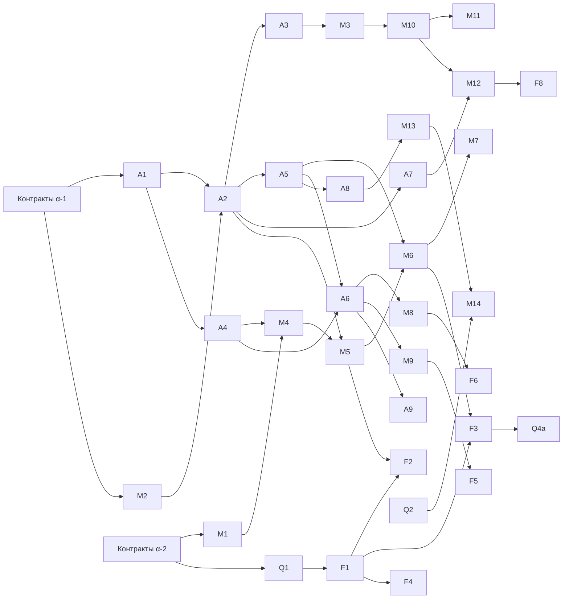

# FinDocs MVP 2.0 — Product Requirements и план реализации

**Документ 1 из 4** комплекта MVP 2.0 (структура принята, решение №23):

1. **`product-requirements.md`** — этот документ: цель, требования, решения, инкременты, команда, план.
2. `architecture2.0.md` (ARCH) + `decisions.md` (ADR-021…040).
3. `mvp2.0_contracts.md` + `openapi.yaml` — контракты API v1 и внутренних модулей.
4. `security-qa.md` — права, информационная безопасность, тестирование, release gates.

Также: `sql/` (эталонная схема PostgreSQL, 186 проверок), `scripts/check_openapi_contract.py` (проверка контракта в CI). Файл `api-security-qa.md` редакции 1 удаляется: его содержимое перенесено в контракты и `security-qa.md`.

| Поле | Значение |
|---|---|
| Основание | ТЗ от 24.11.2026; ревью `report.md` (27.11); решения Максима №1–24 и доработки 1–7 (28.11) |
| Исходный код | `main` @ `8120430` |
| Редакция | 3.1 (28.11.2026): локальные уточнения Максима после редакции 3 |
| Статус | **Draft на согласование**. Решения Максима зафиксированы как `approved`; предложения архитектора, требующие подтверждения, помечены `proposed` |

---

## 1. Цель

**Проблема.** MVP 1.0 доказал путь «загрузил → спросил → ответ с цитатой», но это однопользовательская локальная библиотека: только TXT, без истории диалогов, с лексическим поиском и фоновой обработкой, которая теряется при сбое процесса.

**Цель MVP 2.0.** Многопользовательская система работы с документами. Пользователи регистрируются сами, организуют TXT, PDF и DOCX в папках внутри личных и общих пространств, просматривают документы прямо в интерфейсе, ведут сохраняемые приватные чаты и получают ответы локальной LLM с проверяемыми источниками — от цитаты можно перейти к странице или абзацу. Качество поиска измеряется, а не декларируется. Сервис переживает сбои без потери и без «воскрешения» данных.

**Критерии успеха** (проверка — `security-qa.md` §7.4):

1. Ни одного доступа к чужим данным, включая прямые SQL-тесты под ролью приложения; editor не может удалить чужой документ ни одним путём.
2. Источники PDF и DOCX ведут на корректную страницу или абзац (ручная сверка 20/20), предпросмотр открывает это место.
3. Решение по поиску принято по порогам, зафиксированным до итогового сравнения.
4. История чатов переживает перезагрузку; повтор запроса не создаёт дублей; ответы по удалённым документам скрыты целиком.
5. Перезапуск не теряет документы и задачи; восстановление из бэкапа на чистой машине не возвращает удалённое.
6. Регрессия на материалах MVP 1.0 не хуже исторических результатов.

---

## 2. Пользователи и режим работы

**Режим** (решения №21, №24): локальная разработка и закрытое тестирование внутри команды. Выделенного сервера нет, окружение воспроизводится через Docker Compose. Открытая регистрация — функция, а не публичная доступность. Перед открытием внешним пользователям отдельно решаются подтверждение email, персональные данные, ИБ и инфраструктура.

| Персона | Контекст | Что важно |
|---|---|---|
| Пользователь (студент, аналитик) | личные материалы | ответ с номером страницы, переход к месту в документе, отдельные чаты |
| Руководитель группы | общее пространство, участники — viewer и editor | участники читают и спрашивают; editor не удаляет чужие материалы |
| Администратор окружения | сброс пароля по коду восстановления, бэкапы, восстановление | понятные runbook и CLI |

---

## 3. Границы и инкременты

### 3.1. Обязательно в MVP 2.0

FR-01…FR-09 (раздел 4). Общие пространства и предпросмотр PDF/DOCX обязательны. К 15.12 общие пространства не требуются (решение №2). Перенос данных MVP 1.0 **не входит** (решение №9).

### 3.2. Инкременты (решение №19)

Релиз MVP 2.0 — завершение всех трёх инкрементов. Инкремент закрывается, когда выполнены все его критерии **и** в CI поднят `CONTRACT_REQUIRED_INCREMENT` (`mvp2.0_contracts.md` §1).

| | **α — полный сценарий в личном пространстве** | **β — совместная работа, форматы, предпросмотр** | **γ — качество и эксплуатация** |
|---|---|---|---|
| Функции | открытая регистрация, код восстановления, вход и сессии, сброс пароля через администратора; личное пространство; документы TXT через API v1 (загрузка, список, удаление, скачивание); очередь и worker; **сохраняемые чаты с ограниченной историей**, идемпотентностью и скрытием ответов по удалённым документам; источники TXT; RLS; frontend на v1 | общие пространства (участники, роли, приглашения, передача владения, архив, удаление и восстановление за 7 дней); правило удаления editor в общих пространствах; папки; PDF и DOCX; переобработка; **предпросмотр PDF/DOCX** с переходом к источнику; удаление аккаунта; командное окружение `stand` | embeddings и сравнение lexical/FTS/vector/hybrid; решение о `partial`; бэкапы и учения по восстановлению с журналом удалений; полный E2E и security-прогон; удаление legacy API; замеры производительности |
| Операции OpenAPI | 28 (`x-increment: alpha`) | 25 (`beta`) | 1 (`gamma`) |
| Миграции | `0001_core`, `0002_auth`, `0003_chats` | — (таблицы уже есть) | `0004_embeddings` |
| Зависит от | контракты α-1 (внутренние) и α-2 (OpenAPI) | закрытый α; контракт β | закрытый β; набор QA (Q2) |
| PR | A1–A5; M1–M7; F1–F4; Q1, Q3 (α), **Q4a**, Q5 | A6, A7, A10; M8–M12; F5–F8; Q3 (β) | A8, A9; M13–M15; F9; Q2, **Q4b** |
| Критерии закрытия | CI с `--require-through alpha`; все SQL-тесты; **E2E-α пройден автоматически (Q4a)**; AUTH-01…15, 17…21; SEC-01…13 для личных пространств; CHAT-01…08 (включая **CHAT-07** — история не расширяет scope), 11…16; SRC-04; DOC-01; RAG-05…09, 15; REL-01…04 | CI с `--require-through beta`; WS-01…10; FLD-01…08; DEL-01…06; DOC-02…20; SRC-01…07; PRV-01…08; AUTH-16; SEC-14…24 | gates G1–G7 (`security-qa.md` §7.4); итоговые E2E-01…03 (Q4b); отчёт эксперимента и ADR-031; выполненное восстановление (REL-06, REL-07); legacy API удалён |

### 3.3. Не входит

OCR, изображения, мультимодальность (решение №11); PPTX/XLSX/аудио/облачные диски; публичные ссылки и гостевой доступ; совместное редактирование и комментарии; админ-панель, платежи, мобильное приложение; полное версионирование документов; streaming и агенты; микросервисы, Kubernetes, отдельная векторная БД, Redis/Celery; общие (не приватные) чаты; поиск по истории, закрепление и экспорт чатов; теги и категории (решение №6); перенос папок и документов между пространствами (решение №5); перенос данных MVP 1.0 (решение №9); отображение DOCX «как в Word» (ADR-030); подтверждение email и SMTP (решение №3).

---

## 4. Функциональные требования

### FR-01. Регистрация, вход, восстановление доступа (α; удаление аккаунта — β)

- **Открытая самостоятельная регистрация** по email, имени и паролю, без администратора (решение №3). Email не подтверждается: SMTP нет. Регистрация и вход ограничены по числу попыток.
- При регистрации пользователь один раз получает **код восстановления** и подтверждает, что сохранил его. Новый код можно выпустить, подтвердив пароль.
- Восстановление пароля — через администратора по коду восстановления, без опоры только на email (ADR-024, **approved**). Код вводится в admin-CLI только скрытым интерактивным вводом: никогда через аргументы командной строки, переменные окружения или файлы. Если код утерян — резервная процедура. **Если достоверно установить личность невозможно, сброс пароля запрещён** (`security-qa.md` §3.2).
- Пароль 15–128 символов, проверка по списку скомпрометированных. Серверные cookie-сессии: 12 ч бездействия, абсолютный срок 7 дней. CSRF-защита.
- Профиль, список сессий, «выйти везде», смена пароля (остальные сессии завершаются).
- Удаление аккаунта (β): невозможно, пока пользователь — единственный владелец общего пространства (решение №4). Иначе персональные данные удаляются, документы, папки и пространства, созданные пользователем, остаются, а автор показывается как «Удалённый пользователь» (доработка 4).

Критерии: AUTH-01…19, SEC-12, SEC-20, SEC-22.

### FR-02. Пространства и роли (личное — α, общие — β)

- Личное пространство создаётся при регистрации. Оно единственное, без других участников, не архивируется и не передаётся.
- Общие пространства: участники с ролями (решение №1):
  - **viewer** — просмотр документов и вопросы по ним;
  - **editor** — загрузка, переименование, перемещение, переобработка документов; **удаление только загруженных им**;
  - **owner** — управление всеми документами и участниками.
- Приглашение ссылкой для зарегистрированных пользователей, смена ролей, исключение, выход, передача владения. У пространства всегда один владелец.
- Удаление общего пространства — с 7 днями на восстановление, затем окончательная очистка (решение №4). Архив — только чтение.
- Пространство — граница данных, поиска и прав. При переключении пространства выбор документов и контекст не переносятся.
- При исключении участника его чаты в пространстве удаляются сразу; после повторного вступления старых чатов нет.

Критерии: WS-01…10, DEL-01…06, SEC-01…08, SEC-18, SEC-19, E2E-02.

### FR-03. Папки (β)

- Вложенность до 3 уровней; создание, переименование, перемещение; имя уникально в родителе без учёта регистра (решение №5).
- Удаляются только пустые папки. Через операции с папками нельзя обойти ограничение editor на удаление чужих документов: каскадного удаления нет, автор загрузки неизменяем (`security-qa.md` §2).
- Перенос папок и документов между пространствами не реализуется. Своих прав у папок нет. Тегов нет.
- Библиотека: фильтры по имени, формату, статусу, папке, дате; сортировка; постраничная загрузка (α — без папок).

Критерии: FLD-01…08, DEL-03.

### FR-04. TXT, PDF, DOCX и предпросмотр (TXT — α; PDF, DOCX, предпросмотр — β)

- Единый pipeline с фоновой обработкой. Статус и понятная русская причина ошибки.
- PDF — только текстовый слой. Скан → понятная ошибка; частичный скан → документ готов, но с предупреждением о нераспознанных страницах (решение №11).
- DOCX — абзацы, заголовки, списки, таблицы. Колонтитулы, сноски, надписи и изображения не извлекаются, пользователь видит предупреждение.
- Повторная обработка не делает документ недоступным; при неудаче остаётся прежняя версия.
- Оригиналы и извлечённый текст — в локальном файловом хранилище за `BlobStorage`; метаданные, блоки, чанки и векторы — в PostgreSQL (решение №7).
- **Предпросмотр** (решение №12):
  - PDF — отрисовка оригинала с переходом к странице источника;
  - DOCX и TXT — текстовый вид документа с переходом к абзацу или разделу;
  - подсветка цитаты — где возможно (точная в текстовом виде, по возможности в PDF);
  - скачивание оригинала сохраняется.

  Подход, безопасность и API — `mvp2.0_contracts.md` §11, ADR-030 (proposed). **Технический подход подтверждает Аня до старта F8.**
- Удалённый документ сразу исчезает из списков, поиска, предпросмотра и истории и не восстанавливается.

Критерии: DOC-01…20, PRV-01…08, SEC-14, REL-09.

### FR-05. Чаты (α)

- Несколько **приватных** чатов в пространстве: доступ только у автора, пока он участник; в общих пространствах тоже (решение №14). Список, история после перезагрузки, переименование, архив, удаление.
- Заголовок — из первого вопроса; ручное переименование имеет приоритет.
- Одна генерация в чате одновременно. Повтор после обрыва связи не создаёт дублей.
- Ограниченная история (решение №13):
  - предыдущий вопрос может уточнять поисковый запрос;
  - до двух предыдущих пар идут в контекст генерации;
  - история не расширяет scope и не использует сведения из документов, к которым больше нет доступа;
  - факты в ответе подтверждаются текущими источниками.
- **Удаление документа** (решение №14):
  - скрываются целиком все ответы, при генерации которых он использовался, вместе с цитатами;
  - вопросы и структура истории сохраняются, вместо ответа — уведомление;
  - такие ответы исключаются из контекста следующих запросов;
  - **все** источники скрытого ответа недоступны по старым ссылкам, даже из документов, которые не удалялись;
  - удаление во время генерации, повторная отправка, конкурентная генерация и окончательная очистка — по `mvp2.0_contracts.md` §7.4.

Критерии: CHAT-01…16, SRC-04…06.

### FR-06. Поиск (lexical — α; сравнение — γ)

- Текущий лексический поиск — точка отсчёта и резервный вариант (решение №16). Сравниваются lexical, FTS, vector и hybrid. Стартовая модель embeddings — `multilingual-e5-small`. Окончательный выбор — по качеству, задержкам и ресурсам.
- Сначала замер baseline, затем **до** итогового сравнения фиксируются критерии и пороги (решение №17): Recall@k, MRR, nDCG, точность источников, доля ложных отказов и ложно уверенных ответов, p50/p95 (`security-qa.md` §6).
- Область поиска — всё пространство, папки или конкретные документы. Пустая, отсутствующая или частично неверная — ошибка, никогда не «все документы».

Критерии: RAG-01…10, RAG-14…16, SEC-09, SEC-10; gate G4.

### FR-07. Ответы и источники (α; PDF/DOCX — β)

- Локальная Ollama за адаптером, модель конфигурируется.
- Источники строит сервер: точная цитата из извлечённого текста конкретной версии обработки, документ, позиция (TXT — символы, PDF — страница, DOCX — абзац и раздел; решение №10).
- Статусы `answered` / `insufficient_info`; `partial` — после проверки качества генерации (решение №17).
- В источниках только фрагменты, на которые модель реально опиралась и которые прошли проверку сервера.
- Документ — недоверенный контент: инструкции в нём не исполняются.

Критерии: SRC-01…07, RAG-03, RAG-04, RAG-11…13, RAG-17, RAG-18.

### FR-08. Маршруты и состояния UI

| Маршрут | Инкр. | Ключевые состояния |
|---|---|---|
| `/register` | α | ввод; слабый пароль (с причиной); email занят; 429; **экран кода восстановления** («Сохраните код» + подтверждение) |
| `/login` | α | ввод; неверные данные; блокировка (429 с таймером) |
| `/set-password#token=…` | α | новый пароль по ссылке администратора; недействительная ссылка; успех → новый код восстановления |
| `/w/{id}/library` | α (β — папки, форматы) | пусто; список с фильтрами и постраничной загрузкой; очередь загрузки; статусы; ошибка с причиной; «обновляется» и «обновление не удалось»; предупреждения о страницах. Кнопка «Удалить» — только при `can_delete` (editor — свои, owner — все); viewer не видит кнопок изменения; сервер проверяет сам |
| `/w/{id}/documents/{docId}` | β | предпросмотр: оригинал PDF или текстовый вид; оглавление; переход к странице или абзацу; подсветка; «Документ обновлён после ответа»; «Документ недоступен»; скачать |
| `/w/{id}/chats/{chatId}` | α | новый чат; история; выбор области поиска; ожидание; ответ; недостаточно информации; ошибка + «Повторить» (текст вопроса сохраняется); **«Ответ недоступен: использованный документ удалён»**; источник «файл · стр. N / абзац N» → «Открыть в документе» (β) |
| `/invite#token=…` | β | без входа → вход и возврат; приглашение; недействительно; уже участник |
| `/w/{id}/settings` | β | участники и роли; приглашения; архив; удаление с вводом названия; восстановление в течение 7 дней; передача владения |
| `/account` | α (удаление — β) | профиль; сессии; смена пароля; новый код восстановления; удаление аккаунта |
| Глобальные | α | сессия истекла; «Не найдено»; «Недостаточно прав»; «Сервис недоступен» |

При смене пространства выбор документов сбрасывается; «Все документы пространства» — только явной кнопкой. Mock-режим frontend работает на фикстурах контракта v1.

Критерии: E2E-α, E2E-01…03, AUTH-06, RAG-13, PRV-01…04.

### FR-09. Надёжность и эксплуатация

- Задачи переживают перезапуск; повторы ограничены; устаревшая попытка ничего не публикует (решение №18).
- Понятные коды ошибок и русские сообщения.
- Согласованность БД, файлов и индекса; квоты не превышаются при параллельных загрузках.
- Логи без содержимого; request_id; `/api/health`, `/api/ready`; метрики.
- Воспроизводимое окружение на Docker Compose (решение №24). Миграции схемы обязательны, перенос данных MVP 1.0 — нет (решение №9).
- Бэкап БД и файлов согласованной парой. Восстановление **не возвращает удалённое**: журнал удалений применяется повторно относительно снимка БД (ARCH §13.5, доработка 5).
- Minor-дефекты MVP 1.0 закрываются: №1 (заголовок чата) — M6; №2 (английские ошибки) — M2; №3 (обрывки цитат) — M7. Закрытыми считаются только после проверки QA.

Критерии: REL-01…10.

---

## 5. Нефункциональные требования

| NFR | Требование | Как измеряется | Порог |
|---|---|---|---|
| NFR-SEC | нет доступа к чужим данным через API, поиск, источники, предпросмотр, ошибки, счётчики, логи и прямой SQL под ролью приложения; editor не удаляет чужое; секреты только в хэшах | gate G1 | 100 %, 0 high/critical |
| NFR-DATA | целостность ссылок; нет перепутанных источников; восстановление без потерь и без возврата удалённого | REL-06, REL-07, REL-10, SRC-01, SQL-тесты | 0 расхождений |
| NFR-PERF | p50/p95: список документов, загрузка (202), обработка (на страницу и МБ), поиск, полный ответ, открытие страницы предпросмотра; память при одновременной работе LLM и worker | скрипт на машинах команды с записанными характеристиками; 1/3/5 пользователей; 50/500 документов | **после baseline-замера**; требования к оборудованию — по результатам (решение №24) |
| NFR-RETR | качество поиска и ответов | `security-qa.md` §6 | пороги фиксируются до итогового сравнения |
| NFR-OPS | задачи не теряются; диагностика по request_id; повторяемый запуск; бэкап и восстановление | REL-01…05, REL-07 | 100 % |
| NFR-UX | статусы и ошибки на русском; основные сценарии без обходов | E2E, REL-09 | 100 % |
| NFR-COMPAT | регрессия на материалах MVP 1.0 | DOC-01, RAG-15 | не хуже исторических |

SLA («99,9 %», «ответ за 2 с») не вводятся. Ориентир MVP 1.0: медиана ответа 2–5 с на `qwen3.5:4b-q4_K_M`, холодный старт до 13 с.

---

## 6. Данные и права — коротко

- **Кто владеет документом:** пространство. Автор загрузки фиксирован навсегда и определяет право editor на удаление; после удаления аккаунта он отображается как «Удалённый пользователь».
- **Где хранится:** метаданные, блоки, чанки и векторы — PostgreSQL; оригинал и извлечённый текст — локальное файловое хранилище; путь строится только из UUID.
- **Кто может обратиться:** участники по ролям; к чатам — только автор.
- **Как индексируется:** версии обработки с зафиксированными версиями парсера, токенизатора и модели; переключение атомарное.
- **Как чат использует историю:** ограниченно, без расширения scope и без скрытых ответов.
- **Откуда цитата:** подстрока извлечённого текста конкретной версии; БД отклоняет цитату, не совпадающую с текстом.

---

## 7. Решения

### 7.1. Решения Максима (28.11.2026)

| № | Решение | ADR | Где отражено |
|---|---|---|---|
| 1 | Личные и общие пространства; owner/editor/viewer; viewer спрашивает; editor удаляет только свои | 025 | FR-02; `security-qa.md` §2; `sql/0001` |
| 2 | Общие пространства обязательны в 2.0, к 15.12 не нужны | 025 | §3.2 (β) |
| 3 | Открытая регистрация без SMTP; сброс через администратора без опоры на email; сессии 12 ч / 7 дней; CSRF; throttle | 023, 024 | FR-01; `security-qa.md` §3 |
| 4 | 7 дней на восстановление общего пространства; аккаунт владельца не удаляется до передачи | 025, 037 | FR-02; контракты §9 |
| 5 | Папки до 3 уровней, удаление только пустых, без переноса между пространствами, без обхода через папки | 026 | FR-03; `security-qa.md` §2 |
| 6 | Тегов нет | 026 | §3.3 |
| 7 | Оригиналы и извлечённый текст — локально за `BlobStorage`; остальное — PostgreSQL | 022 | ARCH §6 |
| 8 | PostgreSQL 16, pgvector, SQLAlchemy 2, Alembic, psycopg 3; FastAPI, React, TypeScript, Ollama, модульный монолит | 021 | ARCH §13.1 |
| 9 | Без переноса данных MVP 1.0; чистая БД; MVP 1.0 отдельно; QA-материалы для регрессии; миграции схемы обязательны | 039 | ARCH §14; §3.3 |
| 10 | Якоря: TXT — символы, PDF — страница, DOCX — абзац и раздел; цитаты по конкретной версии | 028 | контракты §10 |
| 11 | Без OCR; ошибка для сканов, предупреждение для частичных | 029 | FR-04 |
| 12 | Предпросмотр PDF и DOCX с переходом к источнику и подсветкой; подход — с Аней; скачивание сохраняется | 030 | FR-04; контракты §11 |
| 13 | Ограниченная история: вопрос для поиска, до 2 пар для генерации, без расширения scope | 032 | FR-05; контракты §7.5 |
| 14 | Приватные чаты; скрытие ответа целиком при удалении документа | 032, 033 | FR-05; контракты §7.4 |
| 15 | `/api/v1`; legacy только на переходе, удалить к концу 2.0; `openapi.yaml` — основной контракт | 034 | контракты §1, §12 |
| 16 | Lexical — baseline и резерв; сравнение четырёх ретриверов; e5-small — старт | 031 | FR-06 |
| 17 | Baseline → пороги до итогового сравнения; метрики; `partial` после проверки | 031 | `security-qa.md` §6 |
| 18 | Очередь в PostgreSQL + worker, без Redis/Celery | 027 | ARCH §7.7 |
| 19 | α/β/γ; релиз = все три; 15.12 — промежуточная точка | — | §3.2, §8.5 |
| 20 | Распределение обязанностей; Иван вне критического пути; код Артёма проверяется независимо, ревью — с Владом | — | §8; `security-qa.md` §7.3 |
| 21 | Локальная разработка и закрытое тестирование; открытая регистрация ≠ публичный доступ | 040 | §2 |
| 22 | Отдельный `docs/mvp2.0/decisions.md`; утверждённое отделено от предложений и открытых вопросов | — | `decisions.md` |
| 23 | Комплект документов принят; `api-security-qa.md` удаляется | — | шапка |
| 24 | Работаем локально, выделенного сервера нет; Docker Compose; оборудование — по замерам; SMTP не подключаем | 040 | ARCH §3.3 |

### 7.2. Предложения после редакции 3

| Вопрос | Статус | Решение | Где |
|---|---|---|---|
| Проверка личности при сбросе пароля | **approved** (окончательно, ADR-024) | код восстановления; без передачи кода через аргументы, окружение и файлы; резервная процедура только при достоверно установленной личности, иначе сброс запрещён | `security-qa.md` §3.2 |
| Технический подход к предпросмотру | **предварительно одобрен** Максимом | PDF.js для PDF, текстовый вид для DOCX и TXT; окончательно — с Аней до начала F8 | ADR-030; контракты §11 |
| Реализация обезличенной записи пользователя | за Артёмом | при сохранении инвариантов I-23 и I-25 | ARCH §5.6 |
| Реализация журнала удалений, выгрузки и восстановления; SQL; проверка pgvector 0.8 | за Артёмом | по требованиям ARCH §13.5 и ADR-038 | A1, A6, A9 |
| RLS и триггеры как второй рубеж | proposed (ADR-036) | ревью Влада и Артёма | A1 |

### 7.3. Открыто до экспериментов и инфраструктуры

Итоговые ретривер и embedding-модель; пороги качества и задержек; включение `partial`; HNSW; требования к оборудованию; SMTP и подтверждение email; библиотека PDF (pdfplumber или PyMuPDF); DOCX «как в Word»; отдельный контейнер-парсер. Сроки и условия — `decisions.md`, раздел «Открытые вопросы».

---

## 8. Команда и план

### 8.1. Роли (решение №20)

| Участник | Роль в MVP 2.0 |
|---|---|
| **Максим Рябов** | project management, системный анализ, **основной backend**: бизнес-логика, API, auth, права, чаты, обработка документов, поиск, RAG, оркестрация worker |
| **Владислав Логинов** | Team Lead: архитектура, технические контракты, ADR, архитектурное ревью; вместе с Максимом — независимое ревью кода Артёма |
| **Артём Дмитриенко** | базы данных, слой хранения, репозитории, инфраструктура, **QA и DevOps** |
| **Анна Жакова** | frontend, UI/UX, интеграция с backend, предпросмотр |
| Иван Фролов | не в критическом пути. При подтверждении — обработка документов (M10, M11) |

Граница backend — внутренние контракты `mvp2.0_contracts.md` §14. Сначала замораживаются контракты α, затем Максим и Артём работают параллельно.

### 8.2. Доступность (заполняют участники до старта α)

| Участник | Часов в неделю на FinDocs | Недоступен (включая 31.12–08.01) |
|---|---|---|
| Максим | _ | _ |
| Артём | _ | _ |
| Влад | _ | _ |
| Аня | _ | _ |

**Календарных недель ≈ идеальных дней × 6 ч / часов в неделю** (+ ревью и интеграция). Окончательные сроки — после заполнения таблицы и замера фактического темпа (решение №19).

### 8.3. PR

Оценки — в идеальных днях. Каждый PR оформляется по шаблону ТЗ: цель, модули, API и DB, миграции, тесты, документация, зависимости, критерии приёмки, назначенный проверяющий. «QA» — кто проверяет по матрице `security-qa.md` §5 (не автор).

**Артём — данные и инфраструктура**

| PR | Инкр. | Содержание | Ревью / QA | Зависит | Оценка |
|---|---|---|---|---|---|
| A1 | α | compose (PostgreSQL по digest), `sql/run_tests.sh --docker` на pgvector 0.8, Alembic: `0001`–`0003` из `sql/`, CI-сервис БД, up/down/up | Влад + Максим | контракты α-1 | 2–3 |
| A2 | α | UoW + контекст RLS + сброс в пуле; `BlobKey`/`BlobStorage`/`blob_objects`; репозитории документов и обработки (контракты §14.1–14.5, 14.7); перевод ошибок БД | Влад + Максим | A1, M2 | 4–5 |
| A3 | α | SQL очереди с fencing, reaper, GC файлов, квоты (контракты §14.6) | Влад + Максим | A2 | 3–4 |
| A4 | α | репозитории пользователей (код восстановления), сессий, токенов, throttle | Влад + Максим | A1 | 2–3 |
| A5 | α | `ScopeResolver` (SQL), репозиторий чатов: T1/T2, идемпотентность, история, скрытие при чтении (контракты §14.8–14.9) | Влад + Максим | A2 | 3–4 |
| A6 | β | общие пространства: участники, приглашения, передача, архив и удаление, папки (дерево с блокировкой), удаление аккаунта, SQL очистки, журнал удалений | Влад + Максим | A4, A5 | 3–4 |
| A7 | β | запросы предпросмотра (блоки по странице и окну, оглавление), `open_range` | Влад + Максим | A2 | 1–2 |
| A8 | γ | SQL FTS и vector, `0004_embeddings`, жизненный цикл моделей | Влад + Максим | A5 | 3–4 |
| A9 | γ | бэкап: экспорт снимка, manifest, пауза GC, выгрузка журнала, `reapply-deletions`, `verify-storage`, учения | Влад + Максим | A6 | 3–4 |
| A10 | β | `compose.stand.yml`: Caddy (заголовки, JSON-ошибки, лимиты, журналы), сети, секреты, проверки `stand` | Влад + Максим | M1 | 2–3 |
| | | **Итого** | | | **26–36** |

**Артём — QA и DevOps**

| PR | Инкр. | Содержание | Ревью | Зависит | Оценка |
|---|---|---|---|---|---|
| Q1 | α | фикстуры контракта, `check_openapi_contract.py` + `oasdiff` + `schemathesis` в CI | Максим, Аня | контракты α-2 | 2–3 |
| Q2 | γ (старт в α) | контрольный набор, разметка якорей, разбиение на настроечную и контрольную части, скрипты метрик, baseline lexical | Влад | — | 5–7 |
| Q3 | α–β | security-тесты: IDOR, CSRF и Origin, тест-«сторож», журналы, заголовки, предпросмотр | Влад | M5; M12 | 4–5 |
| Q4a | α | Playwright: E2E-α — критерий закрытия α | Аня | F3, M6 | 1–2 |
| Q4b | γ | Playwright: итоговые E2E-01…03 | Аня | F5, F8 | 3 |
| Q5 | α | матрица `qa/mvp-2.0-matrix.md`, регрессия на материалах MVP 1.0 | Влад | — | 2–3 |
| | | **Итого** | | | **17–23** |

**Максим — прикладной слой**

| PR | Инкр. | Содержание | Ревью / QA | Зависит | Оценка |
|---|---|---|---|---|---|
| M1 | α | конфигурация и окружения, `/api` и `/api/v1`, middleware (request_id, Origin/CSRF, конверт ошибок), health и ready, legacy-режим | Влад / Артём | контракты α-2 | 2–3 |
| M2 | α | `ProcessingResult` v2 для TXT, якоря, русские ошибки (minor №2), golden-тесты | Артём | контракты α-1 | 2–3 |
| M3 | α | worker: `process_document` с fencing, sweeper, замена `BackgroundTasks` | Артём | A3 | 2–3 |
| M4 | α | регистрация, код восстановления, сессии, CSRF, throttle, Argon2id, CLI сброса | Артём + Влад | A4, M1 | 4–5 |
| M5 | α | `AccessService` и матрица, личное пространство, документы API v1 (правило удаления), тест-«сторож» | Артём | M4, A2 | 4–5 |
| M6 | α | чаты API: T1/T2, идемпотентность, scope, история, скрытие, заголовки (minor №1) | Артём | A5, M5 | 4–5 |
| M7 | α | `LLMAdapter` + `GenerationRequest`, `used_fragments`, источники (minor №3) | Влад | M6 | 2–3 |
| M8 | β | папки API | Артём | A6 | 2–3 |
| M9 | β | общие пространства: участники, приглашения, передача, архив, удаление и восстановление, удаление аккаунта, обработчики очистки | Артём + Влад | A6 | 4–6 |
| M10 | β | PDF + изоляция парсинга + определение формата | Артём | M2, M3 | 4–5 |
| M11 | β | DOCX | Артём | M10 | 3–4 |
| M12 | β | API предпросмотра, `Range` для оригинала | Артём | A7, M10 | 2–3 |
| M13 | γ | `EmbeddingAdapter`, векторы в pipeline, hybrid, деградация, reindex | Влад | A8, M3 | 4–6 |
| M14 | γ | эксперимент по поиску (с Артёмом), решение о `partial`, ADR-031 | Влад | Q2, M13 | 2–3 |
| M15 | γ | удаление legacy API и `LocalFileDocumentRepository` | Влад | F4 | 1–2 |
| | | **Итого** | | | **42–59** |

**Аня — frontend**

| PR | Инкр. | Содержание | Ревью / QA | Зависит | Оценка |
|---|---|---|---|---|---|
| F1 | α | клиент v1 на сгенерированных типах, CSRF, 401/403/404/409, регистрация с экраном кода, вход, `/set-password`, mock v1 | Максим / Артём | Q1 | 4–5 |
| F2 | α | библиотека v1: курсоры, фильтры, загрузка, удаление по `can_delete` | Максим / Артём | F1, M5 | 3–4 |
| F3 | α | чаты: список, история, scope, повтор, `pending`/`failed`/скрытый ответ, источники | Максим / Артём | F1, M6 | 4–5 |
| F4 | α | аккаунт: сессии, пароль, новый код восстановления; глобальные состояния | Максим / Артём | F1 | 1–2 |
| F5 | β | общие пространства: переключатель, участники, приглашения, настройки, удаление аккаунта | Максим / Артём | M9 | 4–5 |
| F6 | β | дерево папок | Максим / Артём | M8 | 2–3 |
| F7 | β | PDF/DOCX: статусы, предупреждения, переобработка | Максим / Артём | M10, M11 | 2–3 |
| F8 | β | предпросмотр: PDF.js, текстовый вид, оглавление, переход и подсветка; согласование подхода (ADR-030) | Максим + Влад / Артём | M12 | 5–7 |
| F9 | γ | доработка интерфейса, доступность, вывод ответа как текста | Артём (E2E) | F8 | 2–3 |
| | | **Итого** | | | **27–37** |

**Влад:** заморозка и сопровождение контрактов и ADR, процесс `contract-change`, совместное с Максимом ревью всех PR Артёма, ревью критичных PR Максима, согласование предпросмотра с Аней — 14–21 день.

**Итог трудоёмкости:** Артём 43–59 (данные 26–36 + QA 17–23), Максим 42–59, Аня 27–37, Влад 14–21. **Всего 126–176 идеальных дней.** Это трудоёмкость, а не календарь. Критический путь — Максим. Если Иван подтвердит участие и возьмёт M10–M11, путь сокращается на 7–9 дней.

### 8.4. Зависимости

Одни и те же протоколы и модели не меняются параллельно разными PR без владельца. A2 начинается после слияния M2, потому что реализует введённые им типы.

### 8.5. Контрольная точка 15.12.2026

Промежуточная точка, **не** дата готовности (решение №19). Формат показа не подтверждён; стабильная версия для показа — MVP 1.0.

| Объём | Что | Кто |
|---|---|---|
| **Обязательно** | редакция 3 согласована; заморожены внутренние контракты α-1 (§14) и OpenAPI α-2 (28 операций) | Влад, Максим, Артём, Аня |
| **Обязательно** | `sql/run_tests.sh --docker` прогнан на `pgvector/pgvector:0.8.0-pg16`, digest закреплён | Артём (ревью — Влад) |
| **Обязательно** | заполнена таблица доступности, пересчитан календарь α | все |
| Дополнительно | A1 слит: PostgreSQL, Alembic 0001–0003, CI с SQL-тестами и проверкой контракта (`--require-through none`) | Артём |
| Дополнительно | M2: `ProcessingResult` v2 для TXT без регрессии | Максим |
| Дополнительно | Q1 + F1 на mock v1 | Артём, Аня |
| Дополнительно | Q2: первые 50 вопросов, baseline lexical | Артём |
| **Не обещается** | аккаунты, очередь, чаты, общие пространства, PDF/DOCX, предпросмотр, гибридный поиск | — |

---

## 9. Риски

| Риск | Вероятность | Влияние | Митигация |
|---|---|---|---|
| Максим совмещает PM, аналитику и основной backend | высокая | критический путь | мелкие PR; Иван — на M10–M11 при подтверждении; ранняя заморозка контрактов |
| Артём совмещает БД, DevOps и QA | высокая | задержки, зависимая приёмка | ревью его кода — Влад и Максим; QA-задачи γ можно сдвигать внутри γ |
| Предпросмотр больше, чем оценено | средняя | β | ADR-030 ограничивает объём (без DOCX «как в Word»); раннее согласование с Аней |
| Нет сервера и данных об оборудовании | высокая | выбор модели, NFR-PERF | e5-small как старт; замеры на машинах команды с записью характеристик |
| Нет SMTP | высокая | email не подтверждается | код восстановления; закрытое тестирование; решение до открытия вовне |
| Код восстановления утерян | средняя | обращения к администратору | резервная процедура с двумя операторами и аудитом |
| Качество извлечения PDF | средняя | неверные цитаты, хуже подсветка | контрольные PDF в Q2; текстовый вид как точный режим |
| Схема не проверена на pgvector 0.8 | низкая | сбой A1 | обязательный прогон в A1; схема не использует возможностей 0.8 |
| Праздники 31.12–08.01 | высокая | календарь | учитываются в §8.2 |

---

## 10. Закрытие замечаний

### 10.1. Доработки редакции 3

| Доработка | Что сделано | Где |
|---|---|---|
| 1. Проверка OpenAPI в CI | `scripts/check_openapi_contract.py`: требует операции только завершённых инкрементов, сверяет реализованные (`operationId`, параметры, тело, коды), строит сокращённый контракт для `oasdiff` и `schemathesis`. Проверен на тестовом FastAPI-приложении | контракты §1 |
| 2. Инкременты и план | α — полный сценарий «регистрация → документ → вопрос → цитата → история → удаление» в личном пространстве (чаты с историей перенесены в α); у каждого инкремента — состав, операции OpenAPI, миграции, PR, зависимости, критерии закрытия; план пересчитан с предпросмотром и без переноса данных | §3.2, §8 |
| 3. Внутренние контракты | `ProcessingResult` v2, `ProcessingRunResult`, `NewDocument`, `DocumentQuery`, `JobLease`, `PublishOutcome`, `ResolvedScope`, `RetrievalResult`, `BlobWriter` и смежные типы: поля, типы, обязательность, результаты, исключения, ответственность за транзакции | контракты §14 |
| 4. Удаление аккаунтов | ссылка на обезличенную запись, «Удалённый пользователь», автор неизменяем; документ такого автора удаляет только owner; реализация в БД — за Артёмом | ARCH §5.2, §5.6; ADR-037; SQL-тест `45_delete_policy.sql` |
| 5. Восстановление из бэкапа | журнал удалений в той же транзакции с `txid`; внешняя выгрузка; точка отсчёта — **снимок БД** из manifest (`pg_visible_in_snapshot`), а не время бэкапа; блокировка запросов до завершения; реализация — Артём | ARCH §13.5; ADR-038; SQL-тест |
| 6. Политика удаления ответов | вариант «скрыть целиком» во всех документах: контракт (`redacted`, `context_changed`), OpenAPI, UI (FR-08), тесты CHAT-08, 13…16; поведение при удалении во время генерации, повторах, очистке и в истории | контракты §7.4; ARCH §9.3; ADR-033 |
| 7. ADR | `decisions.md`: ADR-021…040, статусы `approved` / `proposed` / `open`, связи с ADR MVP 1.0, отдельный список открытых вопросов | `decisions.md` |

### 10.2. Решения Максима

Все 24 решения отражены (§7.1, колонка «Где отражено»). Изменения относительно редакции 2:

- закрытый пилот с регистрацией через администратора → **открытая регистрация** + код восстановления;
- editor удалял любые документы → **только свои**, с защитой в БД;
- предпросмотр не входил → **входит** (β);
- перенос данных MVP 1.0 → **исключён** (импорт, отчёт, runbook переключения, REL-06 в старой формулировке, A8 старого плана);
- демо-сервер → **локально и Docker Compose** (`stand`);
- open №14 → **скрытие целиком**.

### 10.3. Замечания ревью редакции 1 (B-01…B-12, T-01…T-16)

Закрыты в редакции 2. Таблица соответствия сохраняет силу с поправками: B-11 и T-15 больше не включают перенос данных MVP 1.0 (решение №9); B-12 и план пересчитаны в §8; T-05 и T-14 переведены на окружения `dev`/`test`/`stand`. Подробности — `architecture2.0.md`, раздел «Что изменено по ревью».

### 10.4. Уточнения редакции 3.1

| Уточнение | Что сделано | Где |
|---|---|---|
| Код восстановления принят, без передачи через аргументы | ADR-024 → approved; скрытый интерактивный ввод, stdin только для автотестов, запрет в `stand`; тесты AUTH-20, AUTH-21 | `security-qa.md` §3.2; `decisions.md` |
| Резервная процедура | три обязательных условия достоверности; при невыполнении любого — сброс запрещён, `auth.reset_refused`, обходные пути считаются инцидентом | `security-qa.md` §3.2 |
| Предпросмотр | подход предварительно одобрен, окончательное согласование с Аней перед F8 | ADR-030 |
| 1. E2E | Q4 разделён: Q4a (E2E-α, критерий закрытия α) и Q4b (итоговые E2E, γ); CHAT-07 добавлен в критерии α и в сценарий E2E-α | §3.2, §8.3; `security-qa.md` §5.10 |
| 2. Источники скрытого ответа | все источники скрытого ответа по старым ссылкам → `410 source_unavailable`, включая неудалённые документы; `availability=document_deleted` удалён из контракта | контракты §7.4, §10; `openapi.yaml`; SRC-04 |
| 3. Гарантии восстановления | журналируется и отмена удаления пространства; порядок по версии объекта; выгрузка за секунды + тревога при задержке > 5 мин; явная граница гарантии и отчёт окна неопределённости; выгрузка остатка из исходной БД | ARCH §13.5; ADR-038 |
| 4. ADR-024 | окончательно approved | `decisions.md` |
| SQL и pgvector 0.8 | вопросы реализации — за Артёмом | §7.2 |
